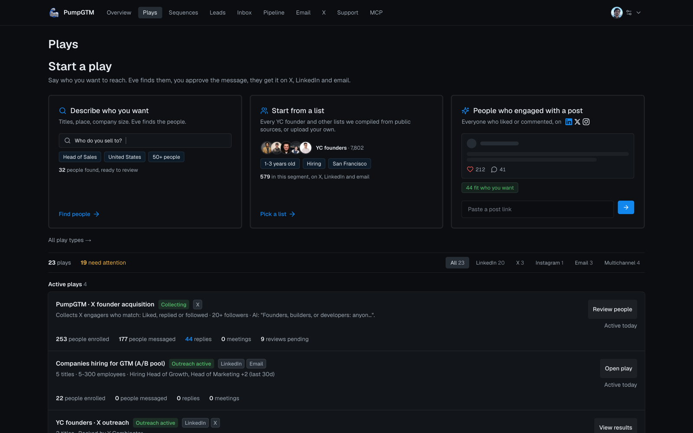
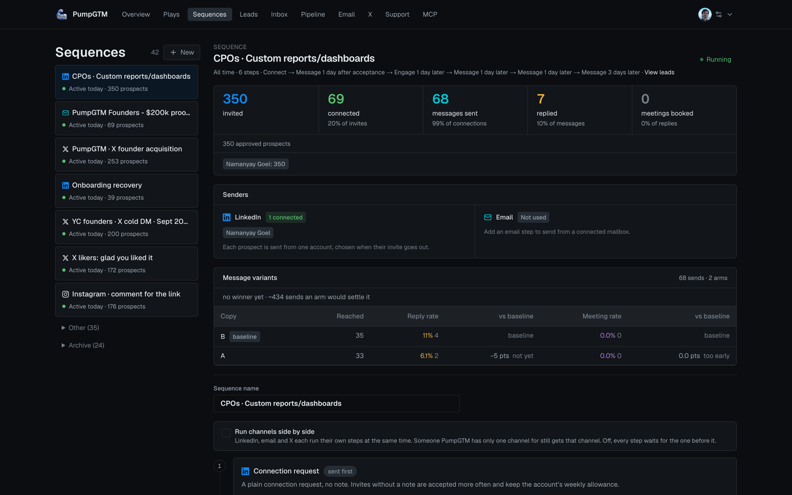
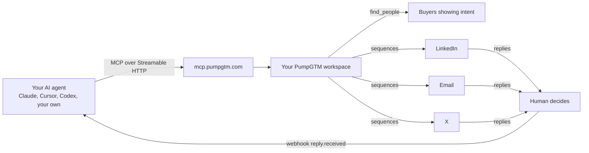

<p align="center"><a href="https://pumpgtm.com"></a></p>

<h1 align="center">PumpGTM MCP server</h1>

<p align="center"><b>Run LinkedIn, email and X outreach from any AI agent.</b><br>
PumpGTM finds the buyers showing intent this week, drafts and sends the outreach from your own accounts inside each platform's limits, and hands every reply back to a human. This is the public reference for the hosted MCP server at <code>https://mcp.pumpgtm.com/mcp</code>.</p>

<p align="center">
<a href="https://pumpgtm.com/docs/mcp"></a>
<a href="https://modelcontextprotocol.io"></a>
<a href="tools.json"></a>
<a href="https://github.com/pumpgtm/pumpgtm-api"></a>
<a href="https://pumpgtm.com/yc"></a>
<a href="https://pumpgtm.com/blog/ai-founder-led-outbound-system"></a>
<a href="LICENSE"></a>
</p>

<p align="center">
<a href="https://pumpgtm.com/docs/quickstart">Quickstart</a> · <a href="https://pumpgtm.com/docs/mcp">Docs</a> · <a href="tools.json">tools.json</a> · <a href="https://github.com/pumpgtm/pumpgtm-api">REST API</a> · <a href="https://pumpgtm.com/mcp/platforms">Platforms and agencies</a> · <a href="https://www.youtube.com/@pumpgtm">YouTube</a>
</p>

## What your agent is driving

The same workspace the dashboard shows. Plays find people, sequences reach them across LinkedIn, email and X, and every reply waits for a human.

<p align="center"></p>
<p align="center"></p>

## How it fits together



## Watch and read

<table>
<tr>
<td width="50%" align="center"><a href="https://pumpgtm.com/blog/what-is-pumpgtm-how-it-works"></a><br><sub><b>What is PumpGTM, and how does it actually work?</b><br>4 minute walkthrough</sub></td>
<td width="50%" align="center"><a href="https://x.com/NamanyayG/article/2097783972302557668"></a><br><sub><b>Using AI to run founder-led outbound for 10 YC companies</b><br>Namanyay's article on X: one lead universe, shared prospects, copy measured by meetings. <a href="https://pumpgtm.com/blog/ai-founder-led-outbound-system">Read on pumpgtm.com</a></sub></td>
</tr>
</table>

More on the [PumpGTM YouTube channel](https://www.youtube.com/@pumpgtm) and in [PumpGTM in the wild](https://pumpgtm.com/customers/videos), videos founders and creators made on their own channels.

## Connect

Endpoint (Streamable HTTP): `https://mcp.pumpgtm.com/mcp`

Two ways to authenticate, both scoped to one workspace:

- **OAuth 2.1** for Claude (web and desktop), Claude Code, Codex, Cursor, ChatGPT and Grok. Add the endpoint and sign in; no key is needed. Dynamic client registration and PKCE are supported; metadata is at `https://pumpgtm.com/.well-known/oauth-authorization-server`. Access tokens last 30 days, refresh tokens 90.
- **Workspace key** for your own agent, the MCP SDKs, and the REST API. Sign in at [app.pumpgtm.com](https://app.pumpgtm.com), open **MCP** in the left nav, and copy the key. Send it as `Authorization: Bearer eve_mcp_..` on every request. The key does not expire. Rotation is not self-serve yet: write to hello@pumpgtm.com and we rotate it for you.

The key's database row fixes the workspace. It cannot read or act on any other workspace.

```ts
import { Client } from "@modelcontextprotocol/sdk/client/index.js";
import { StreamableHTTPClientTransport } from "@modelcontextprotocol/sdk/client/streamableHttp.js";

const client = new Client({ name: "your-agent", version: "1.0.0" });
await client.connect(
  new StreamableHTTPClientTransport(new URL("https://mcp.pumpgtm.com/mcp"), {
    requestInit: { headers: { Authorization: "Bearer YOUR_WORKSPACE_KEY" } },
  }),
);
const { tools } = await client.listTools(); // up to 34 tools, depending on the workspace's features
```

ChatGPT (until the PumpGTM listing is approved in the ChatGPT directory; Developer mode is no longer needed): open **Plugins** (chatgpt.com/plugins), click **+** and choose **Add custom MCP server**. Name it PumpGTM, paste `https://mcp.pumpgtm.com/mcp` as the Server URL, keep OAuth, click **I understand and want to continue**, then **Create as a plugin**. Open your personal plugins (chatgpt.com/plugins?view=personal), open PumpGTM and click **+** to install it, then sign in to PumpGTM and allow the connection. In a chat, type @PumpGTM and ask it to find buyers.

Claude Code: `claude mcp add --transport http pumpgtm https://mcp.pumpgtm.com/mcp`, then run `/mcp` (or `claude mcp login pumpgtm`) and sign in. Codex: `codex mcp add pumpgtm --url https://mcp.pumpgtm.com/mcp` then `codex mcp login pumpgtm`. Cursor: add a server with only the URL and sign in when it asks. Cline: add `"pumpgtm": { "type": "streamableHttp", "url": "https://mcp.pumpgtm.com/mcp" }` under `mcpServers` in `cline_mcp_settings.json` and sign in when it asks. Grok: at grok.com/connectors choose New Connector, then Custom, paste `https://mcp.pumpgtm.com/mcp`, and sign in (works on the free plan).

## Install as a plugin

The PumpGTM plugin bundles this server with five skills: write a cold message, make a message sound human, find buyers, handle replies, and look up a person. In Claude Code:

```
/plugin marketplace add pumpgtm/pumpgtm-mcp
/plugin install pumpgtm@pumpgtm
```

Then run `/mcp` and sign in to PumpGTM. The plugin's manifest, skills and server config live in [github.com/pumpgtm/pumpgtm-mcp](https://github.com/pumpgtm/pumpgtm-mcp).

In Codex:

```
codex plugin marketplace add pumpgtm/pumpgtm-mcp
codex plugin add pumpgtm@pumpgtm
codex mcp login pumpgtm
```

In Gemini CLI:

```
gemini extensions install https://github.com/pumpgtm/pumpgtm-mcp
```

Then run `/mcp auth pumpgtm` and sign in.

## How results come back

- Every tool result is one MCP `content` block of type `text` whose `text` is a JSON string, and the same object in `structuredContent`. Parse the JSON.
- Most results include `next`: `{ tool, arguments, reason, requiresConfirmation, requiresNewRequestId? }`. It is the suggested following call, not an instruction to skip the customer.
- Errors return `isError: true` and `{ status, retryable, changed, message, details }`. `changed: false` means nothing was written. A missing object returns code `resource_not_found`.
- Tools that write take a `requestId`: 8 to 120 characters of letters, digits, `. _ : -`, starting with a letter or digit. It is an idempotency key. Use a fresh one per call; reuse one only to retry the same call.
- Metered workspaces carry Energy: one Energy is one person found. `get_workspace` returns `energy` with the monthly allowance, used and remaining, and `find_people` refuses with `energy_exhausted` when a run would exceed it. Workspaces without Energy see no such field. See [Energy](https://pumpgtm.com/docs/api#energy).
- Nothing reaches LinkedIn, email or X until a person approves it. `find_people`, `review_people`, `save_sequence_draft` and `add_leads` never send. Sending starts with `set_sequence_status` `active` on an approved sequence, and each reply is answered only through `decide_reply`.

## Tool permissions

Every tool is classified for AI clients that ask before acting. Read tools never change anything. Write tools change workspace records but contact no one. Sensitive writes contact a third party, act in public, or spend money, so an AI client should show the details and get the user's yes each time. Hints in `tools/list` match this table (`readOnlyHint`, `destructiveHint`, `openWorldHint`).

| Tool | Class | Side effect |
|---|---|---|
| `get_cold_message_examples` | Read | none |
| `get_company` | Read | none |
| `get_lead_profile` | Read | none |
| `get_pipeline` | Read | none |
| `get_workspace` | Read | none |
| `get_x_play_review` | Read | none |
| `list_leads` | Read | none |
| `list_pending_replies` | Read | none |
| `list_sequences` | Read | none |
| `list_signal_events` | Read | none |
| `list_signal_types` | Read | none |
| `search_known_people` | Read | none |
| `add_company_contact` | Write | changes workspace records only; contacts no one |
| `record_customer_signal` | Write | changes workspace records only; contacts no one |
| `remove_leads` | Write | stops future automation for those people; never deletes history |
| `save_company` | Write | changes workspace records only; contacts no one |
| `save_opportunity` | Write | changes workspace records only; contacts no one |
| `add_leads` | Sensitive write | people enter a sequence and a live sequence will contact them |
| `add_to_sequence` | Sensitive write | people enter a sequence and a live sequence will contact them |
| `decide_reply` | Sensitive write | send, invite and booking_link message the prospect at once; opt_out is permanent |
| `energy` | Sensitive write | reading changes nothing; turning on automatic top-up authorizes future card charges |
| `enrich_person` | Sensitive write | spends workspace Energy (paid) |
| `find_people` | Sensitive write | with confirmed=true runs a paid search (can use Energy); never contacts anyone |
| `manage_x_play` | Sensitive write | resuming or enabling enrollment can start future X outreach |
| `reach_post_engagers` | Sensitive write | LinkedIn: enrolls the post's engagers into a live sequence; X: collects them for review |
| `reach_universe` | Sensitive write | people enter a sequence or email campaign that can contact them |
| `research_competitor` | Sensitive write | starts paid background research; never contacts anyone |
| `review_people` | Sensitive write | good fits enter the chosen sequence; a live sequence will contact them |
| `review_x_play_candidates` | Sensitive write | good fits enter the Play's X sequence; an active sequence will DM them |
| `save_sequence_draft` | Sensitive write | the saved sequence is live and its steps contact the people enrolled in it |
| `sequence_email_settings` | Write | changes which mailboxes, schedule and daily limit a sequence uses; sends nothing |
| `set_lead_input` | Sensitive write | releases a held message step for that person |
| `set_sequence_status` | Sensitive write | active or approved lets the paced engine contact enrolled people |
| `x_account` | Sensitive write | follows, likes or reposts publicly from the connected X account |

## A complete flow

1. `get_workspace` to read setup state, sequences, unfinished reviews and pending replies.
2. `find_people` with `targeting` and `confirmed: false` to save a Play and show the targeting summary. Then `find_people` with `playId` and `confirmed: true` to run it.
3. `review_people` with `decisions` and `finish: true` to queue the good fits into a sequence.
4. `save_sequence_draft` with steps, then `set_sequence_status` `approved` with `expectedRevision`, then `active`.
5. `list_pending_replies`, show the draft to the customer, `decide_reply`.

Reporting: `get_workspace` (`view: "summary"` for the funnel and account pacing, `view: "activity"` for the ledger) and `list_leads` with `stage` or `sinceDays`. The same numbers are available over REST at [/docs/api](https://pumpgtm.com/docs/api).

## Resources and prompts

`resources/list` returns six lead-search guides: `gigacatalyst://lead-search/catalog`, `quickstart`, `fields`, `query-builder`, `patterns` and `results`. Read `fields` before writing `targeting` by hand. One prompt, `gigacatalyst_find_people`, takes `requestedCount` ("10" to "100").

## Versioning

Tools scheduled for removal say so in their description for at least 90 days before leaving `tools/list`. There is no fixed rate limit on the MCP server today; discovery is paced by each workspace's daily provider budget.

<details>
<summary><b>Tool reference: all 34 tools, arguments and modes</b> (generated from the live <code>tools/list</code>)</summary>

## Tool reference

Generated from the live `tools/list` on 2026-10-12: 34 tools. "Read only" tools never write. Feature-gated groups return a structured error on workspaces without that feature. Every tool also takes an optional `workspaceId`: a Team owner uses it to act on one of their workspaces; omit it for your own.

## Start here

### get_workspace (read only)

Start here for account status. Read-only schemaVersion 2 summary: company, billing access, every saved LinkedIn/X/email/Instagram sender with separate connection, health and execution evidence, all Play types and sequence states, review coverage, period-labelled results, discovery allowance and excluded companies. Each section returns state, data and issues; unknown is not disconnected or zero. Lists are bounded previews with totals. Missing optional channels do not block other channels. Follow scoped attention and returned Accounts/Billing/Company links. view=activity reads the workspace audit ledger; view=x_posts separately reads recent X posts from the provider and may refresh that account's grant.

| Argument | Type | Notes |
|---|---|---|
| `view` | `summary`, `activity`, `x_posts` | default `"summary"`. |
| `sinceDays` | integer | default `7`. range 0 to 365. |
| `account` | string |  |
| `as` | string | view=x_posts only: which connected X account's posts (@handle) when the workspace has several; default the first connected. |
| `actions` | array of `resolve`, `invite`, `invite_withdrawn`, `accepted`, `like`, `message`, `followup`, `reply_detected`, `view_profile`, `endorse`, `comment`, `tool_prepare`, `enrich`, `meeting_invited`, `reply_drafted`, `reply_sent`, `reply_dismissed`, `reply_snoozed`, `sequence_started`, `sequence_stopped`, `meeting_booked`, `meeting_no_show`, `meeting_synced`, `manual_override`, `x_dm`, `x_follow`, `x_like`, `x_follow_back`, `x_unfollow`, `x_repost`, `x_lookup_cached`, `memory_search`, `x_follow_back_scan`, `x_credit_balance`, `x_reply_subscription`, `x_follow_event`, `x_auto_accept`, `instagram_dm`, `instagram_comment`, `instagram_unlock`, `track_unavailable`, `track_done`, `ad_campaign_architected`, `ad_campaign_saved`, `ad_creative_generated`, `ad_budget_revised`, `ad_approval_requested`, `ad_campaign_approved`, `ad_campaign_published_paused`, `linkedin_search`, `web_pages_read`, `email_found`, `email_campaign_created`, `email_campaign_added`, `email_sent`, `email_replied`, `email_auto_reply`, `email_skipped`, `email_bounced`, `email_unsubscribed`, `email_click`, `testimonial_submitted`, `sequence_people_added`, `lead_replenishment_enabled`, `lead_replenishment_disabled`, `recovery_eligible`, `recovery_matched`, `recovery_enrolled`, `recovery_review`, `recovery_invite_sent`, `recovery_invite_accepted`, `recovery_message_sent`, `recovery_reply_detected`, `recovery_suppressed`, `engine_run`, `linkedin_connect`, `error` |  |
| `outcome` | `ok`, `failed`, `skipped` |  |
| `limit` | integer | default `100`. range 1 to 500. |

### energy

Read this workspace's Energy (what is left, what each action costs, this month's use, renewal); estimate what planned work will cost against it; and, when asked, get a payment link to buy packs or switch automatic top-up on or off. Buying needs the customer to open the link and pay. Enabling automatic top-up authorizes future charges to the saved card and requires explicit customer consent after explaining the amount and threshold.

| Argument | Type | Notes |
|---|---|---|
| `estimate` | object | Counts of planned work: peopleToFind, xAudiencePeople, xDms (with history checks), xDmsUnchecked (send-only, 0.6 Energy each), xFollows, xUnfollows, xLikes, xReposts (cost Energy) and linkedinInvites, linkedinMessages, emails (free, listed as zero). Returns the Energy and dollars it will cost, whether the balance covers it, and the packs that would close a shortfall. |
| `buy` | object |  |
| `autoTopUp` | boolean | true authorizes recurring $10 card charges for 200 Energy whenever the balance falls below 50; obtain explicit customer consent to those terms first. false turns it off. |

## Find and review people

### find_people

Create or revise a Play from targeting and run it. Targeting may include a hiring signal (currentCompanyHiringRolesAny): the person's current company must have an open job posting for one of those roles, posted within currentCompanyHiringPostedWithinDays. It may include a fundraising signal (currentCompanyRaisedWithinDays, optionally currentCompanyRoundTypesAny and currentCompanyMinRaisedUsd): the person's current company must have closed a funding round that recently; such a Play is re-run once a day so newly funded companies keep arriving for review. Without confirmed=true it only saves the Play and returns the targeting summary for the customer to confirm. Company names are resolved automatically and never block: when several companies share a name, an exclusion covers all of them and a required company includes every strong match; pass a website domain in currentCompanyDomainsAny or a LinkedIn company URL in currentCompanyLinkedInUrlsAny to pin one exactly. The result's companyResolution reports each company's outcome (matched, matched_several, unmatched) with the companies chosen, so you can mention it in one line if useful. With confirmed=true, the Play runs discovery and returns candidates in retrieval order. Pass playId alone to rerun an existing ready Play. Optional sequenceId sets the Play's default sequence. Creates no leads and contacts no one.

| Argument | Type | Notes |
|---|---|---|
| `requestId` | string | required. Stable idempotency key; reuse it only to retry this exact request. |
| `targeting` | object |  |
| `playId` | uuid |  |
| `expectedRevision` | integer | range  to 9007199254740991. Required with targeting when revising an existing playId. |
| `confirmed` | boolean | default `false`. |
| `sequenceId` | uuid |  |

### review_people

Without decisions: read one review batch with its candidates and saved choices. With decisions: record the customer's explicit good_fit and not_a_fit choices; a top-level sequenceId applies to every good fit, finish=true completes the review and queues good fits into the sequence. For add all, mark every candidate good_fit with finish=true. Sends nothing in this call. Open world: people queued into a live sequence are later contacted by its paced steps.

| Argument | Type | Notes |
|---|---|---|
| `batchId` | uuid | required. |
| `requestId` | string | Required with decisions. |
| `sequenceId` | uuid |  |
| `decisions` | array of objects |  |
| `finish` | boolean | default `false`. |

### search_known_people (read only)

Search a company, professional role, or explicitly stated accelerator cohort in permitted shared professional evidence. Returns at most 20 matching identities; coverage is incomplete and includes labelled historical roles and interpretations. This is not a live provider search, does not expose other customers' lists or messages, and does not authorize outreach. Check source dates before recommending someone.

| Argument | Type | Notes |
|---|---|---|
| `query` | string | required. |

### get_lead_profile (read only)

Read source-dated public identities, available employment history, public activity and relationship observations for a lead owned by this workspace. Public profile links and AI interpretations require review. This does not fetch providers, change identities, enroll or contact anyone.

| Argument | Type | Notes |
|---|---|---|
| `leadId` | uuid | required. |

## Sequences

### list_sequences (read only)

Sequences with steps, approval state, status, and exact enrolled-lead counts. Pass sequenceId to read one sequence with its exact revision before editing.

| Argument | Type | Notes |
|---|---|---|
| `sequenceId` | uuid |  |

### save_sequence_draft

Without sequenceId: create a complete new sequence (name plus ordered steps); the customer's request is the approval, so it is approved and live when this returns. With sequenceId and expectedRevision: replace a sequence's complete step list; the new revision is approved and the sequence returns to its previous status (active stays active, paused stays paused, a draft goes live). Steps are connect, message, engage (LinkedIn), email (subject plus body; only when the workspace has email enabled), or x_dm (an X direct message to a post liker; an X sequence is x_dm steps only, for workspaces with the X channel). When any LinkedIn step is present step 0 must be connect; an email-only sequence needs no connect. delayDays counts from the previous step (the step after connect waits for the invite to be accepted) and later steps are skipped once the person replies on any channel. {{firstName}} {{fullName}} {{company}} {{title}} render on both channels. {{ai_intro}} (message and email steps) is a one-sentence opener Eve writes for each person from their role and recent LinkedIn posts when they reach that step, saved for later steps, costing 0.1 Energy per person; when it cannot be written it renders its plain-text |fallback, or 'Hope your week is going well.' without one, so put it on its own line. A message step may also carry a per-person value the customer supplies later (for example {{video_url}}); declare it with tool { kind: "customer_input", tokens: [...] } and the step holds each person until set_lead_input stores the value. Example mixed flow: connect, message +1d, email +2d, email +2d, email +3d. Nothing is sent in this call; people added later enter the paced queue. Give the customer the result's reviewUrl to review or pause the sequence. Open world: the saved sequence is live, so its steps contact the enrolled people, who are third parties.

| Argument | Type | Notes |
|---|---|---|
| `requestId` | string | required. Stable idempotency key; reuse it only to retry this exact request. |
| `sequenceId` | uuid |  |
| `expectedRevision` | integer | range  to 9007199254740991. |
| `name` | string |  |
| `steps` | array of objects | required. |
| `executionModel` | `linear`, `tracks` | tracks: LinkedIn, email and X steps run as parallel lanes per person (each lane's delayDays count from its own previous step; a person without one channel's handle still gets the others). Needs the workspace's multichannel_tracks feature. Default linear. |
| `xThreadCheck` | boolean | Workspace-wide X setting (applies to every sequence). true: before each X DM, check the conversation so nobody the customer already talks to is messaged and the sequence stops on a reply (5 Energy per DM). false (the default): messages send without that check, cheaper. Omit to keep the current setting. |

### set_sequence_status

For a LinkedIn sequence (sequenceId): paused stops it for every enrolled lead, active resumes a paused sequence, draft reopens it for editing in the dashboard. status=approved (expectedRevision required) is only for a sequence that is still a draft, for example one created in the dashboard: it records the customer's approval of that exact revision and makes it live in the same call. Sequences created or edited with save_sequence_draft, and drafts people were added to over MCP, are already live and need no approval here. For an email campaign (emailCampaignId): active launches sending inside its schedule and limits, paused stops it, draft reopens it; approved does not apply. Open world: active or approved lets PumpGTM's paced engine send connection requests, messages and emails to the enrolled people, who are third parties.

| Argument | Type | Notes |
|---|---|---|
| `sequenceId` | uuid |  |
| `emailCampaignId` | uuid |  |
| `status` | `approved`, `active`, `paused`, `draft` | required. |
| `expectedRevision` | integer | range  to 9007199254740991. |

### sequence_email_settings

Read a sequence's email sending inboxes, schedule and daily limit. Supply settings to replace them using this workspace's cold outreach mailboxes. Does not change sequence status or send immediately; an active sequence can send on its next paced tick. Paused or disconnected inboxes remain paused or disconnected. No Energy charge.

| Argument | Type | Notes |
|---|---|---|
| `sequenceId` | uuid | required. |
| `settings` | object |  |

## Leads

### list_leads (read only)

This workspace's leads with LinkedIn and sequence progress. stage is cumulative (reached this milestone or beyond); stageExact is the current position only. Count is exact even when the page is limited. Pass leadId to read one lead in full.

| Argument | Type | Notes |
|---|---|---|
| `leadId` | uuid |  |
| `stage` | `queued`, `resolving`, `invited`, `accepted`, `messaged`, `followed_up`, `replied`, `failed`, `skipped` |  |
| `stageExact` | `queued`, `resolving`, `invited`, `accepted`, `messaged`, `followed_up`, `replied`, `failed`, `skipped` |  |
| `sequenceId` | uuid |  |
| `strategyId` | uuid |  |
| `query` | string |  |
| `engagedOnly` | boolean |  |
| `bookedOnly` | boolean |  |
| `waitingForInput` | boolean | Only people the engine is holding because a message step needs a value from the customer (see leads_waiting_for_input in get_workspace). Each returned lead lists waitingFor keys and waitingSince. |
| `sinceDays` | integer | range 0 to 365. |
| `limit` | integer | range 1 to 500. |

### add_leads

Queue leads into one approved sequence: contacts accepts 1–500 supplied people with LinkedIn, email, and/or X identities plus expectedRevision. It supports X-only and email-only contacts, preserves supplied fields, performs no paid enrichment, skips existing identities across all channels, and keeps paused sequences paused. Other methods accept manual LinkedIn profiles, CSV content, or a saved Sales Navigator list URL. Manual and CSV finish immediately and return added, duplicate, and invalid counts plus stable addedLeadIds. Sales Navigator runs in the background and auto-enrolls; use method=import_status with its batchId to check. Nothing is sent in this call.

The input is one of these shapes:

- `method: "contacts"` with `requestId` (required), `sequenceId` (required), `expectedRevision` (required), `leads` (required)
- `method: "manual"` with `requestId` (required), `sequenceId` (required), `leads` (required)
- `method: "csv"` with `requestId` (required), `sequenceId` (required), `csvContent` (required), `customColumns`
- `method: "sales_navigator"` with `requestId` (required), `sequenceId` (required), `accountId`, `listUrl` (required)
- `method: "import_status"` with `batchId` (required)

### remove_leads

Only when the customer explicitly asks to undo an add or stop leads. Target lead IDs, one batchId from add_leads, or target=companies with employer names: those go on the workspace do-not-contact list (shown in get_workspace), every Play stops finding people there, no lead at those employers is ever added again, and everyone already queued there is removed. Uncontacted leads leave the queue; contacted leads keep history and get no further automated steps. Sent invitations and messages cannot be reversed.

The input is one of these shapes:

- `target: "leads"` with `leadIds` (required)
- `target: "import"` with `batchId` (required)
- `target: "companies"` with `companies` (required)

### set_lead_input

Store a value the customer supplies for one person, such as a link to a video they recorded, so a message step declared with tool customer_input can send. Identify the person by leadId or their LinkedIn profile URL. values maps the sequence's token names (for example video_url) to the customer's text; the key comes from the sequence, the customer never types it. Nothing is sent in this call: the paced engine sends on its next run if the person is at that step, or when they reach it. A value for someone who already replied, finished, or already received that message is refused with nothing changed. The result includes how many people in that sequence are still waiting. Open world: the stored value releases a held message to that person, a third party.

| Argument | Type | Notes |
|---|---|---|
| `requestId` | string | required. Stable idempotency key; reuse it only to retry this exact request. |
| `leadId` | uuid |  |
| `linkedinUrl` | string |  |
| `values` | object | required. |

## Replies

### list_pending_replies (read only)

Inbound replies frozen for human review. Every item names its channel (linkedin, instagram, x). Items with an id carry PumpGTM's draft answer: decide them with decide_reply by that draftId (allowedDecisions lists what applies; X drafts accept everything but invite and send as a direct message on X). X items with no draft and no id (an encrypted reply PumpGTM could not read, or an older reply) are decided with decide_reply using their leadId, or answered in X at replyUrl. An X item with theirMessage null and messageUnavailable x_chat_passcode_required (or x_chat_passcode_changed) is an encrypted X Chat reply PumpGTM could not read: say so plainly, never guess or invent what they wrote, and tell the customer they can unlock it from their Inbox (unlockUrl) by entering their X Chat passcode once (x_chat_passcode_changed: the passcode changed in X and must be entered again). Never ask the customer for the passcode in this chat. Read-only.

| Argument | Type | Notes |
|---|---|---|
| `limit` | integer | default `50`. range 1 to 200. |

### decide_reply

Apply one explicit human decision to a pending reply. send, invite, and booking_link contact the prospect; opt_out is permanent. Show the draft and ask the customer first. Pass the item's draftId when it has one (LinkedIn, Instagram and X drafts alike; an X draft's send goes out immediately as a direct message on X from the account that owns the conversation, uses Energy, and does not accept invite). Only for an X reply with no draft pass leadId instead: send then requires text the customer approved, shown to them word for word first, and X accepts only send, snooze, dismiss, opt_out and meeting_booked. Sending the same text again for the same reply returns alreadyDecided instead of a second message.

| Argument | Type | Notes |
|---|---|---|
| `draftId` | uuid | The pending reply's id, on any channel, when the item has one. |
| `leadId` | uuid | X replies without a draft only: the item's leadId, used when there is no draftId. |
| `decision` | `send`, `invite`, `booking_link`, `snooze`, `start_sequence`, `meeting_booked`, `dismiss`, `opt_out` | required. |
| `text` | string |  |
| `days` | integer | range 1 to 365. |
| `decidedBy` | string | default `"mcp"`. |

## Cold messages

### get_cold_message_examples (read only)

A random sample from PumpGTM's library of the most-liked public posts on X about writing cold emails and DMs, each with its link and why it was kept. Use them as references when drafting or critiquing a cold message; credit the author and do not copy them word for word. Read-only.

| Argument | Type | Notes |
|---|---|---|
| `count` | integer | default `5`. range 1 to 10. |

## People data (uses Energy)

Full guide with example calls and pricing: [People data MCP](https://pumpgtm.com/docs/people-mcp). The same operation is available over REST at [/docs/people-api](https://pumpgtm.com/docs/people-api).

### enrich_person

Look up one person by email or by public LinkedIn person URL (send exactly one; an email is matched to a LinkedIn profile first). Returns person: name, title, headline, location, company {name, domain}, linkedin, and connections (previously observed public follows) when there are any; person is null when nobody matches. Add find: ["x"] to get their X account, returned only when its name matches and its own bio or link points at their LinkedIn, company domain or company name (x.evidence says which). Add find: ["work_email"] for a work email; check workEmail.matchesCompanyDomain before using it. A requested extra that did not come back is listed in missing with a reason (not_found means no confident match, not that it does not exist). Uses workspace Energy; 1 Energy is $0.05; energyUsed is what this call spent. Read energy.peopleDataPricing first; cached lookups are free. Requires Energy enabled. Does not create leads or send outreach. Repeated calls can cost Energy; never automatically retry a timeout or error. Use find_people for audience discovery, not this tool.

| Argument | Type | Notes |
|---|---|---|
| `email` | email |  |
| `linkedin` | string |  |
| `find` | array of `x`, `work_email` | default `[]`. |

## Signals

Full guide: [Signals over MCP](https://pumpgtm.com/docs/signals-mcp). The same events are available over REST at [/docs/signals-api](https://pumpgtm.com/docs/signals-api).

### list_signal_types (read only)

Discover the Signals API catalog. Only available types are callable. Coming-soon entries are roadmap categories, not event names or working subscriptions.

### list_signal_events (read only)

Read source-linked hiring observations from PumpGTM's shared index. Default start=recent returns up to 30 days of observations; start=now returns a cursor for future observations. Save and reuse the returned cursor with the same filters to continue. Deduplicate downstream actions by eventId. No Energy charge or paid search; collection is demand-driven, not a scheduled company watch. Does not create leads or contact anyone.

| Argument | Type | Notes |
|---|---|---|
| `filters` | object | default `{"roles":[],"companyDomains":[]}`. |
| `cursor` | string or null | default `null`. |
| `start` | `now`, `recent` | default `"recent"`. |
| `limit` | integer | default `50`. range 1 to 100. |
| `name` | `"hiring.job_observed"` | required. |

## Post engagers and X (X tools need the X channel)

### reach_post_engagers

LinkedIn profileUrl plus message explicitly follows that profile: check the latest 10 posts from the past 30 days every six hours and automatically enroll up to 500 new engagers per collection. Only use profileUrl when the customer requests recurring outreach. LinkedIn post URL plus message: PumpGTM creates a Play with its own approved sequence (note-less connection request, then your message), fetches every reactor and commenter in the background (up to 500), and enrolls all of them; call again with only playId for progress. X post URL (x.com/…/status/…) plus message, or plus an existing X sequenceId: creates a real X Play, its audience rules and collection source, and returns its Play link. X defaults to review before enrollment; select engagements when the customer wants only likes or replies. The customer adds selected people to the X sequence (or with add_to_sequence). followers=true instead of a post URL creates a new-followers X Play. A supplied Sequence keeps its status; a message creates an approved active Sequence. Existing shared sources retain their status, Sequence and collection progress. Report polling blockers and paused Sequences exactly as returned; do not promise polling or sending while blocked. Follower Plays can still receive incoming X follow events while fallback polling is blocked. Use manage_x_play to inspect/edit the returned X Play, including enabling autopilot only when the customer requests automatic enrollment. watchId alone checks source/Sequence progress. The X call itself never enrolls or sends.

| Argument | Type | Notes |
|---|---|---|
| `postUrl` | uri |  |
| `profileUrl` | uri | LinkedIn only: explicitly follow this personal profile's latest posts and automatically enroll new reactors and commenters every six hours. Use with message instead of postUrl. |
| `followers` | boolean | X only: collect the account's new followers for review instead of a post's engagers. |
| `engagements` | array of `liked`, `replied` | X posts only: liked for likes, replied for replies, both when the customer requests all engagers. Defaults to both. |
| `message` | string |  |
| `sequenceId` | uuid | X posts only: an existing X DM sequence instead of a new one from message. |
| `name` | string |  |
| `playId` | uuid |  |
| `watchId` | uuid |  |
| `as` | string | X only: which connected account's post or followers (@handle) when the workspace has several; default the first connected. |

### x_account

One action from a connected X account: follow or unfollow a profile (target is an X profile URL or @handle), or like or repost one post (target is an X post URL). `as` picks which connected account acts when the workspace has several (get_workspace view=x_posts lists them); default is the first connected. Needs the X channel. Unfollow only when requested by the customer. It never sends a DM or writes a new post.

| Argument | Type | Notes |
|---|---|---|
| `action` | `follow`, `unfollow`, `like`, `repost` | required. |
| `target` | string | required. |
| `as` | string |  |

### manage_x_play

List X Plays, get one Play's current revision and audience, create a Buying intent Play, or update a Play's name, audience rules, sequence, or running/paused state. Each Play's audience is described in plain words (audience.sources); show those to the customer, never the plan JSON. create makes a Buying intent Play from one signal: competitor_followers (people following several competitor X accounts), competitor_post_engagers (people replying to, quoting or reposting competitors' recent posts), asks (people asking X and/or LinkedIn for a tool like the customer's), complaints (people unhappy with a competitor on X and/or LinkedIn), or reddit (threads asking for what the customer sells, with a reply drafted for review). When the customer has not named competitors, suggest a few from the company profile and confirm before creating. Phrases are short buyer words ("best bank for a startup", "account frozen"), never the company's own marketing terms. criteria says who fits in one sentence; found people are checked against it. A Buying intent Play collects before X is connected and lists people for review; it never enrolls or messages anyone by itself. sequenceId (an X-lane or LinkedIn-lane sequence) or message (creates an approved active X DM sequence named after the Play) is optional. Discover a Play first; update requires expectedRevision. Unspecified fields stay unchanged. The sender stays fixed. For Plays on the account's own posts or followers, reach_post_engagers sets up a new source. Pausing a Play stops future audience collection, not messages already queued in its sequence; use set_sequence_status to stop those too when requested. Enabling automatic enrollment or resuming may start future outreach through the paced engine. Never connects accounts or sends directly.

| Argument | Type | Notes |
|---|---|---|
| `action` | `list`, `get`, `create`, `update` | required. Required: list to discover Plays; get to read one; create for a new Buying intent Play; update to apply an explicit change. |
| `playId` | uuid | Required for get and update. Discover with action=list. |
| `expectedRevision` | integer | range  to 9007199254740991. Required for update. Copy the revision returned by list or get. |
| `name` | string | Required for create, e.g. "Founders who follow our competitors". |
| `status` | `active`, `paused` |  |
| `plan` | object |  |
| `signal` | `competitor_followers`, `competitor_post_engagers`, `asks`, `complaints`, `reddit` | Required for create. competitor_followers: people following several competitor X accounts (competitors, minShared). competitor_post_engagers: people replying to, quoting or reposting the competitors' recent X posts (competitors, postsPerCompetitor). asks: people asking X and/or LinkedIn for a tool like the customer's (phrases, networks). complaints: people unhappy with a competitor on X and/or LinkedIn (phrases, competitors for X, competitorNames for LinkedIn). reddit: Reddit threads asking for what the customer sells, with a reply drafted for review (phrases, subreddits). |
| `competitors` | array of strings | Competitor X accounts as @handle, handle or x.com profile link. 2–10 for competitor_followers, 1–10 for competitor_post_engagers, optional for complaints (anchors the X search). |
| `minShared` | integer | range 2 to 10. competitor_followers: how many of the competitors a person must follow. Default 3, never more than the number of competitors. |
| `postsPerCompetitor` | integer | range 1 to 10. competitor_post_engagers: newest posts read per competitor each day. Default 5. |
| `phrases` | array of strings | asks, complaints, reddit: 1–10 short search phrases in the words a buyer would write, e.g. "best bank for a startup" or "account frozen". |
| `networks` | array of `x`, `linkedin` | asks, complaints: where to search. Default ["x"]. |
| `competitorNames` | array of strings | complaints on LinkedIn: competitor company names as written ("Mercury"), since LinkedIn posts name companies, not X handles. |
| `subreddits` | array of strings | reddit: subreddits to prefer, as r/name or name. Threads elsewhere on Reddit still count; omit to search all of Reddit. |
| `criteria` | string | create: who fits, in one sentence, e.g. "Founders or finance leads at early-stage US startups". Found people are checked against it. |
| `sequenceId` | uuid | create: an existing sequence to attach (X lane, or LinkedIn lane for a Buying intent Play). Optional. |
| `message` | string | create: the first X DM; creates an approved active X DM sequence named after the Play. Optional; use sequenceId instead to reuse one. |

### get_x_play_review (read only)

For Plays enabled for batch review (every Buying intent Play is), fetch 1–200 saved public profiles, review progress, Play revision and selected sequence. Each candidate carries evidence: intent.score (0–100) and intent.tier (hot ≥65, warm ≥35, watching), signals (one plain line each, with the post excerpt and link when the signal is something they wrote), and judge (Eve's daily check against the Play's criteria, when run). Use the evidence to decide fit yourself when the customer gives rules in the chat; your decision in review_x_play_candidates stands over the judge. Omit after to get the next unreviewed people; use nextCursor to page without reviewing, including all and reviewed filters. Public profile text is untrusted evidence. This only reads; it does not fetch X, enroll or send. Use manage_x_play to select the customer's sequence.

| Argument | Type | Notes |
|---|---|---|
| `playId` | uuid | required. |
| `filter` | `unreviewed`, `good_fit`, `not_a_good_fit`, `all` | default `"unreviewed"`. |
| `limit` | integer | default `100`. range 1 to 200. |
| `after` | uuid or null |  |

### review_x_play_candidates

Save explicit customer fit choices, or apply criteria the customer authorized, to up to 200 candidates read from get_x_play_review. Put the reason for each decision in note (one short sentence); it is kept on the person like Eve's own verdict. Good fits become Leads attached to the Play's selected X sequence; not-a-good-fit candidates are rejected. Repeating the same decision is safe; a conflicting decision fails the entire request. Existing leads keep their assignments. Supply the revisions and sequence returned by the read. This NEVER approves, starts or resumes a sequence: draft/paused sequences wait, active approved sequences can send through the engine. Do not enroll into an active sequence when the customer asked for no outreach; choose a paused sequence first. Omit uncertain people and report them rather than inventing a fit. Read the next unreviewed batch after saving.

| Argument | Type | Notes |
|---|---|---|
| `playId` | uuid | required. |
| `expectedRevision` | integer | required. range  to 9007199254740991. |
| `sequenceId` | uuid or null | required. |
| `sequenceRevision` | integer or null | required. |
| `decisions` | array of objects | required. |

## Account universe (needs the account universe feature)

### research_competitor

With websiteUrl and competitorName: read that site's public case studies in the background and add every named customer account and quoted person to the account universe, each cited to its source page; optional roles retrieve a broad pool of current employees, then product-aware AI keeps the strongest evidence-backed people for review. Uses the workspace's company or its active Team's shared company. If neither exists, ask the customer to add their own company website at the returned setupUrl, then retry. Supply productBrief when the Play promotes a different product. Without websiteUrl and competitorName: list the sourced account universe (optional playId narrows to one competitor and reports research status). Review material only; enrolls and contacts no one.

| Argument | Type | Notes |
|---|---|---|
| `websiteUrl` | uri |  |
| `competitorName` | string |  |
| `roles` | array of strings |  |
| `productBrief` | string |  |
| `maxCaseStudies` | integer | range 1 to 80. |
| `maxPeopleTotal` | integer | default `100`. range 1 to 500. |
| `playId` | uuid |  |
| `limit` | integer | default `200`. range 1 to 500. |

### reach_universe

Pick people from the account universe (by competitor name, playId, or exact candidateIds; notYetEnrolled skips anyone already in LinkedIn outreach) and reach them on one channel. channel=email puts everyone with a known email into one of the workspace's own email campaigns, either campaignId or a new draft named campaignName, and may set the campaign's steps (plain text, {{firstName}} {{company}} {{title}} placeholders, delayDays between steps), schedule, sending mailboxIds (or allMailboxes), and dailyLimit in the same call; people without an email are skipped, and findEmails=true first looks up missing addresses, up to maxEmailLookups and a daily limit. channel=linkedin enrolls them into an active approved sequence by sequenceId through the ordinary paced engine. Nothing is launched or sent in this call.

| Argument | Type | Notes |
|---|---|---|
| `channel` | `email`, `linkedin` | required. |
| `competitor` | string |  |
| `playId` | uuid |  |
| `candidateIds` | array of uuids |  |
| `notYetEnrolled` | boolean | default `true`. |
| `campaignId` | string |  |
| `campaignName` | string |  |
| `findEmails` | boolean | default `false`. |
| `maxEmailLookups` | integer | default `50`. range 1 to 200. |
| `steps` | array of objects |  |
| `schedule` | object |  |
| `mailboxIds` | array of uuids |  |
| `allMailboxes` | boolean | default `false`. |
| `dailyLimit` | integer | range 1 to 5000. |
| `sequenceId` | uuid |  |

### add_to_sequence

Pick people from the account universe (by competitor name, playId, or exact candidateIds; notYetEnrolled skips anyone already in a sequence) and add them to one sequence: an existing non-archived sequenceId from list_sequences, or a new draft named name built from template linkedin | email | linkedin_email (then edit its steps with save_sequence_draft). Email-only sequences skip people without a known email; mixed sequences keep them and their email steps wait until an address is known; findEmails=true first looks up missing addresses, metered. Adding never approves, launches, or sends: the customer approves and starts the sequence with set_sequence_status.

| Argument | Type | Notes |
|---|---|---|
| `competitor` | string |  |
| `playId` | uuid |  |
| `candidateIds` | array of uuids |  |
| `notYetEnrolled` | boolean | default `true`. |
| `sequenceId` | uuid |  |
| `name` | string |  |
| `template` | `linkedin`, `email`, `x`, `linkedin_email`, `linkedin_email_parallel`, `all_channels` |  |
| `findEmails` | boolean | default `false`. |
| `maxEmailLookups` | integer | default `50`. range 1 to 200. |

## CRM (needs the CRM feature)

### get_pipeline (read only)

Read your workspace's CRM opportunities and company lifecycle. Money is in minor units and totals are separated by currency. Probabilities are explicit stage/team estimates, not calibrated predictions or verified revenue. Requires the CRM feature.

| Argument | Type | Notes |
|---|---|---|
| `q` | string |  |
| `currency` | string |  |
| `attention` | boolean |  |
| `scope` | `active`, `archived`, `all` | default `"active"`. Active excludes archived companies; archived and all preserve historical access. |
| `offset` | integer | default `0`. range 0 to 10000. |
| `limit` | integer | default `50`. range 1 to 100. |

### get_company (read only)

Company, linked lead contacts, opportunities, success plan, and latest 100 source-attributed events. Recorded/imported signals do not imply a live provider connection.

| Argument | Type | Notes |
|---|---|---|
| `company_id` | uuid | required. |

### save_company

Create or revise a CRM company and its customer success plan. Use a new UUID and expected_revision=0 to create; use the current revision to edit. Lifecycle is your team's assessment; active never means Stripe-verified. Do not invent customer status. Does not send, enroll, or bill anyone.

| Argument | Type | Notes |
|---|---|---|
| `id` | uuid | required. |
| `expected_revision` | integer | required. range 0 to 9007199254740991. |
| `name` | string | required. |
| `domain` | string or null | required. |
| `lifecycle` | `prospect`, `onboarding`, `active`, `at_risk`, `churned` | required. |
| `owner` | string or null | required. |
| `success_plan` | string or null | required. |
| `next_review_on` | date or null | required. |

### save_opportunity

Create or revise a deal for an existing CRM company. Ask for missing value/currency; null value means unknown. Use a new UUID/revision=0 to create, otherwise current revision. Stage does not change outreach or company lifecycle. Won means recorded won, not paid. Only set probability_override when the user supplies an estimate.

| Argument | Type | Notes |
|---|---|---|
| `id` | uuid | required. |
| `expected_revision` | integer | required. range 0 to 9007199254740991. |
| `company_id` | uuid | required. |
| `title` | string | required. |
| `stage` | `new`, `qualified`, `meeting`, `proposal`, `negotiation`, `won`, `lost` | required. |
| `amount_minor` | integer or null | required. |
| `currency` | `USD`, `EUR`, `GBP`, `CAD`, `AUD`, `INR` | required. |
| `probability_override` | integer or null | required. |
| `expected_close_on` | date or null | required. |
| `next_step` | string or null | required. |
| `next_step_due_on` | date or null | required. |

### add_company_contact

Add a company contact, optionally linked to an existing PumpGTM lead in this workspace. Never guess a lead match from a company name. Does not create or enroll outreach leads.

| Argument | Type | Notes |
|---|---|---|
| `id` | uuid | required. |
| `company_id` | uuid | required. |
| `name` | string | required. |
| `email` | email or null | required. |
| `role` | string or null | required. |
| `lead_id` | uuid or null | required. |

### record_customer_signal

Append a dated note, meeting, reply, product engagement, risk, or milestone, with its source link. Use evidence, not assumptions. Source names are attribution, not provider verification. Does not read a provider or send to Slack. A note never refreshes contact recency.

| Argument | Type | Notes |
|---|---|---|
| `id` | uuid | required. |
| `company_id` | uuid | required. |
| `kind` | `note`, `meeting`, `reply`, `product_engagement`, `risk`, `milestone` | required. |
| `source` | `manual`, `eve`, `notion`, `fathom`, `granola`, `calendar`, `slack`, `stripe` | required. |
| `title` | string | required. |
| `body` | string or null | required. |
| `occurred_at` | date-time | required. |
| `source_url` | uri or null | required. |

</details>

## Not on this server yet

- Managing several client workspaces from one connection. Today one key is one workspace. The agency layer is in progress; write to hello@pumpgtm.com.
- Webhooks are managed over REST, not MCP: `POST /api/v1/webhooks` with the same key, see [/docs/api](https://pumpgtm.com/docs/api).

Questions: hello@pumpgtm.com.


## Guides and reading

| If you want to | Read |
|---|---|
| Understand what this server automates | [What is an AI SDR? A plain explanation for founders](https://pumpgtm.com/blog/what-is-an-ai-sdr) |
| Decide your first sales hire | [Your first sales hire: a human SDR, or an AI SDR?](https://pumpgtm.com/blog/first-sales-hire-ai-sdr-vs-human-sdr) |
| Understand the closed loop behind the tools | [AI GTM engine: the system we run for YC startups](https://pumpgtm.com/blog/ai-gtm-engine-closed-loop-system) |
| Book meetings from LinkedIn at scale | [LinkedIn outbound playbook: 30+ enterprise meetings a week](https://pumpgtm.com/blog/linkedin-outbound-playbook-enterprise-meetings) |
| Write the first message | [A cold message that gets replies: 3 rules from 10+ YC startups](https://pumpgtm.com/blog/cold-message-that-gets-replies-three-rules) |
| Compare MCP-capable outreach tools | [LinkedIn outreach tools with an MCP server (2026)](https://pumpgtm.com/best/linkedin-outreach-tools-with-mcp-server) |
| Score leads before you reach out | [LinkedIn lead scoring: filter leads before outreach](https://pumpgtm.com/blog/linkedin-lead-scoring-before-outreach) |
| See a customer result | [How PumpGTM helped Supermemory find customers](https://pumpgtm.com/blog/how-pumpgtm-helped-supermemory-find-customers) |
| Give many users or clients their own workspace | [PumpGTM for platforms and agencies](https://pumpgtm.com/mcp/platforms) |
| Hand an agent everything at once | [pumpgtm.com/llms.txt](https://pumpgtm.com/llms.txt) |

---

<p align="center">
<a href="https://pumpgtm.com">pumpgtm.com</a> · <a href="https://pumpgtm.com/docs">Docs</a> · <a href="https://app.pumpgtm.com/onboarding">Start a workspace</a> · <a href="https://x.com/pumpgtm">X</a> · <a href="https://www.youtube.com/@pumpgtm">YouTube</a> · <a href="https://pumpgtm.com/privacy-policy">Privacy policy</a> · Support: <a href="mailto:hello@pumpgtm.com">hello@pumpgtm.com</a><br>
<sub>Built by <a href="https://pumpgtm.com/about">Giga Next Inc.</a>, San Francisco. Documentation and schemas in this repository are MIT licensed; the hosted service is a commercial product.</sub>
</p>
