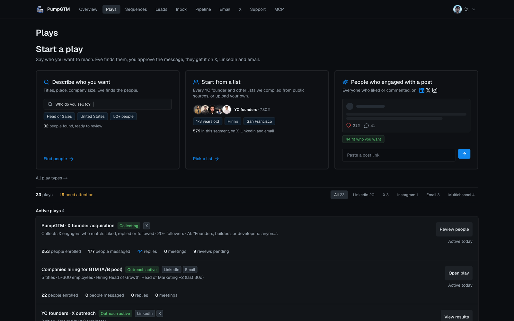
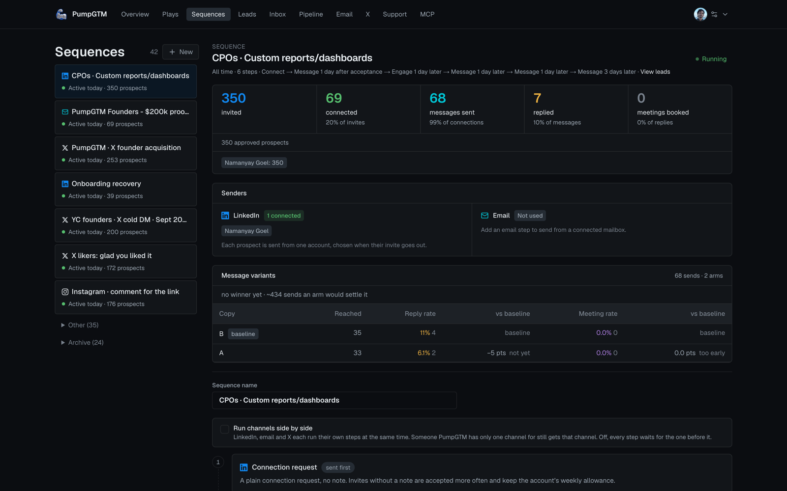
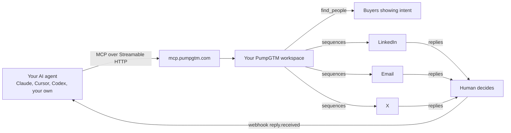

<p align="center"><a href="https://pumpgtm.com"></a></p>

<h1 align="center">PumpGTM MCP server</h1>

<p align="center"><b>Run LinkedIn, email and X outreach from any AI agent.</b><br>
PumpGTM finds the buyers showing intent this week, drafts and sends the outreach from your own accounts inside each platform's limits, and hands every reply back to a human. This is the public reference for the hosted MCP server at <code>https://mcp.pumpgtm.com/mcp</code>.</p>

<p align="center">
<a href="https://pumpgtm.com/docs/mcp"></a>
<a href="https://modelcontextprotocol.io"></a>
<a href="tools.json"></a>
<a href="https://github.com/pumpgtm/pumpgtm-api"></a>
<a href="https://pumpgtm.com/yc"></a>
<a href="https://pumpgtm.com/blog/ai-founder-led-outbound-system"></a>
<a href="LICENSE"></a>
</p>

<p align="center">
<a href="https://pumpgtm.com/docs/quickstart">Quickstart</a> · <a href="https://pumpgtm.com/docs/mcp">Docs</a> · <a href="tools.json">tools.json</a> · <a href="https://github.com/pumpgtm/pumpgtm-api">REST API</a> · <a href="https://pumpgtm.com/mcp/platforms">Platforms and agencies</a> · <a href="https://www.youtube.com/@pumpgtm">YouTube</a>
</p>

## What your agent is driving

The same workspace the dashboard shows. Plays find people, sequences reach them across LinkedIn, email and X, and every reply waits for a human.

<p align="center"></p>
<p align="center"></p>

## How it fits together



## Watch and read

<table>
<tr>
<td width="50%" align="center"><a href="https://pumpgtm.com/blog/what-is-pumpgtm-how-it-works"></a><br><sub><b>What is PumpGTM, and how does it actually work?</b><br>4 minute walkthrough</sub></td>
<td width="50%" align="center"><a href="https://x.com/NamanyayG/article/2097783972302557668"></a><br><sub><b>Using AI to run founder-led outbound for 10 YC companies</b><br>Namanyay's article on X: one lead universe, shared prospects, copy measured by meetings. <a href="https://pumpgtm.com/blog/ai-founder-led-outbound-system">Read on pumpgtm.com</a></sub></td>
</tr>
</table>

More on the [PumpGTM YouTube channel](https://www.youtube.com/@pumpgtm) and in [PumpGTM in the wild](https://pumpgtm.com/customers/videos), videos founders and creators made on their own channels.

## Connect

Endpoint (Streamable HTTP): `https://mcp.pumpgtm.com/mcp`

Two ways to authenticate, both scoped to one workspace:

- **OAuth 2.1** for Claude (web and desktop), Claude Code, Codex, Cursor, ChatGPT and Grok. Add the endpoint and sign in; no key is needed. Dynamic client registration and PKCE are supported; metadata is at `https://pumpgtm.com/.well-known/oauth-authorization-server`. Access tokens last 30 days, refresh tokens 90.
- **Workspace key** for your own agent, the MCP SDKs, and the REST API. Sign in at [app.pumpgtm.com](https://app.pumpgtm.com), open **MCP** in the left nav, and copy the key. Send it as `Authorization: Bearer eve_mcp_..` on every request. The key does not expire. Rotation is not self-serve yet: write to hello@pumpgtm.com and we rotate it for you.

The key's database row fixes the workspace. It cannot read or act on any other workspace.

```ts
import { Client } from "@modelcontextprotocol/sdk/client/index.js";
import { StreamableHTTPClientTransport } from "@modelcontextprotocol/sdk/client/streamableHttp.js";

const client = new Client({ name: "your-agent", version: "1.0.0" });
await client.connect(
  new StreamableHTTPClientTransport(new URL("https://mcp.pumpgtm.com/mcp"), {
    requestInit: { headers: { Authorization: "Bearer YOUR_WORKSPACE_KEY" } },
  }),
);
const { tools } = await client.listTools(); // up to 38 tools, depending on the workspace's features
```

ChatGPT (until the PumpGTM listing is approved in the ChatGPT directory; Developer mode is no longer needed): open **Plugins** (chatgpt.com/plugins), click **+** and choose **Add custom MCP server**. Name it PumpGTM, paste `https://mcp.pumpgtm.com/mcp` as the Server URL, keep OAuth, click **I understand and want to continue**, then **Create as a plugin**. Open your personal plugins (chatgpt.com/plugins?view=personal), open PumpGTM and click **+** to install it, then sign in to PumpGTM and allow the connection. In a chat, type @PumpGTM and ask it to find buyers.

Claude Code: `claude mcp add --transport http pumpgtm https://mcp.pumpgtm.com/mcp`, then run `/mcp` (or `claude mcp login pumpgtm`) and sign in. Codex: `codex mcp add pumpgtm --url https://mcp.pumpgtm.com/mcp` then `codex mcp login pumpgtm`. Cursor: add a server with only the URL and sign in when it asks. Cline: add `"pumpgtm": { "type": "streamableHttp", "url": "https://mcp.pumpgtm.com/mcp" }` under `mcpServers` in `cline_mcp_settings.json` and sign in when it asks. Grok: at grok.com/connectors choose New Connector, then Custom, paste `https://mcp.pumpgtm.com/mcp`, and sign in (works on the free plan).

## Install as a plugin

The PumpGTM plugin bundles this server with five skills: write a cold message, make a message sound human, find buyers, handle replies, and look up a person. In Claude Code:

```
/plugin marketplace add pumpgtm/pumpgtm-mcp
/plugin install pumpgtm@pumpgtm
```

Then run `/mcp` and sign in to PumpGTM. The plugin's manifest, skills and server config live in [github.com/pumpgtm/pumpgtm-mcp](https://github.com/pumpgtm/pumpgtm-mcp).

In Codex:

```
codex plugin marketplace add pumpgtm/pumpgtm-mcp
codex plugin add pumpgtm@pumpgtm
codex mcp login pumpgtm
```

In Gemini CLI:

```
gemini extensions install https://github.com/pumpgtm/pumpgtm-mcp
```

Then run `/mcp auth pumpgtm` and sign in.

## How results come back

- Every tool result is one MCP `content` block of type `text` whose `text` is a JSON string, and the same object in `structuredContent`. Parse the JSON.
- Most results include `next`: `{ tool, arguments, reason, requiresConfirmation, requiresNewRequestId? }`. It is the suggested following call, not an instruction to skip the customer.
- Errors return `isError: true` and `{ status, retryable, changed, message, details }`. `changed: false` means nothing was written. A missing object returns code `resource_not_found`.
- Tools that write take a `requestId`: 8 to 120 characters of letters, digits, `. _ : -`, starting with a letter or digit. It is an idempotency key. Use a fresh one per call; reuse one only to retry the same call.
- Metered workspaces use Energy at the current prices returned by `energy`. `get_workspace` returns `energy` with the monthly allowance, used and remaining, and `find_people` refuses with `energy_exhausted` when a run would exceed it. Workspaces without Energy see no such field. See [Energy](https://pumpgtm.com/docs/api#energy).
- Nothing reaches LinkedIn, email or X until a person approves it. `find_people`, `review_people`, `save_sequence_draft` and `add_leads` never send. Sending starts with `set_sequence_status` `active` on an approved sequence, and each reply is answered only through `decide_reply`.

## Tool permissions

Every tool is classified for AI clients that ask before acting. Read tools never change anything. Write tools change workspace records but contact no one. Sensitive writes contact a third party, act in public, or spend money, so an AI client should show the details and get the user's yes each time. Hints in `tools/list` match this table (`readOnlyHint`, `destructiveHint`, `openWorldHint`).

| Tool | Class | Side effect |
|---|---|---|
| `get_cold_message_examples` | Read | none |
| `get_company` | Read | none |
| `get_lead_profile` | Read | none |
| `get_pipeline` | Read | none |
| `get_workspace` | Read | none |
| `get_x_play_review` | Read | none |
| `list_leads` | Read | none |
| `list_pending_replies` | Read | none |
| `list_sequences` | Read | none |
| `list_signal_events` | Read | none |
| `list_signal_types` | Read | none |
| `search_known_people` | Read | none |
| `get_people_search` | Read | none |
| `list_x_plays` | Read | none |
| `plan_campaigns` | Read | none |
| `energy` | Read | none |
| `preview_workspace_setup` | Read | reviews the drafted setup; saves nothing |
| `check_campaign` | Read | counts matching profiles (up to 3 size checks a day); saves nothing and uses no Energy |
| `add_company_contact` | Write | changes workspace records only; contacts no one |
| `record_customer_signal` | Write | changes workspace records only; contacts no one |
| `remove_leads` | Write | stops future automation for those people; never deletes history |
| `save_company` | Write | changes workspace records only; contacts no one |
| `save_opportunity` | Write | changes workspace records only; contacts no one |
| `save_workspace_setup` | Write | saves the confirmed company profile and setup answers; contacts no one |
| `build_campaigns` | Write | creates Plays with draft messages that send nothing |
| `create_x_play` | Write | creates a Buying intent Play that collects people for review; enrolls and messages no one |
| `edit_x_play` | Write | changes an X Play's audience or sequence; a Play that enrolls automatically routes future people differently |
| `add_leads` | Sensitive write | people enter a sequence and a live sequence will contact them |
| `add_to_sequence` | Sensitive write | people enter a sequence and a live sequence will contact them |
| `decide_reply` | Sensitive write | send, invite and booking_link message the prospect at once; opt_out is permanent |
| `enrich_person` | Sensitive write | spends workspace Energy (paid) |
| `reach_post_engagers` | Sensitive write | LinkedIn: enrolls the post's engagers into a live sequence; X: collects them for review |
| `reach_universe` | Sensitive write | people enter a sequence or email campaign that can contact them |
| `research_competitor` | Sensitive write | starts paid background research; never contacts anyone |
| `review_people` | Sensitive write | good fits enter the chosen sequence; a live sequence will contact them |
| `review_x_play_candidates` | Sensitive write | good fits enter the Play's X sequence; an active sequence will DM them |
| `save_sequence_draft` | Write | saves an unapproved draft; explicit revision approval is required to make it live |
| `sequence_email_settings` | Write | changes which mailboxes, schedule and daily limit a sequence uses; sends nothing |
| `set_lead_input` | Sensitive write | releases a held message step for that person |
| `set_sequence_status` | Sensitive write | active or approved lets the paced engine contact enrolled people |
| `x_account` | Sensitive write | follows, likes or reposts publicly from the connected X account |
| `buy_energy` | Sensitive write | returns a payment link; nothing is charged until the customer pays |
| `set_auto_top_up` | Sensitive write | turning it on authorizes future recurring card charges |
| `find_people` | Sensitive write | with confirmed=true runs the requested search using existing Energy; discovery does not contact anyone; list mode with a sequence can enroll people |
| `set_x_play_status` | Sensitive write | resuming or enabling automatic enrollment can start future X outreach |

## A complete flow

1. `get_workspace` to read setup state, sequences, unfinished reviews and pending replies.
2. For a clear search request, read `get_workspace view=search_methods`, then call `find_people` with `targeting`, `confirmed: true` and a new `requestId`. Use the requested count, or five for a new search without one. Poll the returned `operationId` with `get_people_search` until it completes. A preview or save-only request uses `confirmed: false` and does not authorize discovery.
3. Show every returned person in order and ask which to add. For a new sequence, `save_sequence_draft` saves an unapproved draft. Show its full copy and audience, then call `set_sequence_status` with `status: approved` and `expectedRevision` only after the customer approves that revision.
4. `review_people` with the customer's `decisions` adds their chosen people to the approved sequence; `finish: true` is optional. Do not ask for another yes to repeat an already-approved action.
5. `list_pending_replies`, show the draft to the customer, then `decide_reply` after their decision.

Requested discovery within existing Energy and the agreed scope and budget needs no additional confirmation. Check costs privately, report known usage briefly with results, and mention the remaining balance only when asked or it blocks the work. Ask before guessing an audience, exceeding agreed usage, making a new charge or enabling automatic top-up. Keep discovery answers focused on targeting and results; address legal or safety concerns when concrete context makes them relevant to the requested action or the customer asks.

Reporting: `get_workspace` (`view: "summary"` for the funnel and account pacing, `view: "activity"` for the ledger) and `list_leads` with `stage` or `sinceDays`. The same numbers are available over REST at [/docs/api](https://pumpgtm.com/docs/api).

## Resources and prompts

`resources/list` returns six lead-search guides: `gigacatalyst://lead-search/catalog`, `quickstart`, `fields`, `query-builder`, `patterns` and `results`. Read `fields` before writing `targeting` by hand. One prompt, `find_and_review_leads`, takes `requestedCount` ("5" to "100", default "5").

## Versioning

Tools scheduled for removal say so in their description for at least 90 days before leaving `tools/list`. There is no fixed rate limit on the MCP server today; discovery is paced by each workspace's daily provider budget.

<details>
<summary><b>Tool reference: all 38 tools, arguments and modes</b> (generated from the live <code>tools/list</code>)</summary>

## Tool reference

Generated from the live `tools/list` on 2026-11-10: 69 tools. "Read only" tools never write. Feature-gated groups return a structured error on workspaces without that feature. Every tool also takes an optional `workspaceId`: a Team owner uses it to act on one of their workspaces; omit it for your own.

## Start here

### get_workspace (read only)

Start here: what works right away, what is connected, what is running and what to do next. Read-only. The default summary (schemaVersion 2) returns readyNow (free work, then each tool's Energy price; lead with it and raise billing only when a request needs it), company, billing access, every saved LinkedIn/X/email/Instagram sender with separate connection, health and execution evidence, all Play types and sequence states, review coverage, period-labelled results, discovery allowance, excluded companies and the GTM profile (setup answers: proof, warm sources, ideas, channels, exclusions, goal, team; edit at editUrl). Each section returns state, data and issues; unknown is not disconnected or zero, so say which section is unavailable on a partial result. A saved connection does not prove live provider health, and an active sequence does not prove sending. Report every connected sender with its channel, including several LinkedIn or X accounts. Lists are bounded previews with totals and hasMore, not the whole inventory. Respect metric units and periods, and never assign action totals to a channel by guessing. Missing optional channels, LinkedIn included, do not block other channels. Follow scoped attention and returned Accounts/Billing/Company links, and never invent an onboarding requirement. When attention includes leads_waiting_for_input, say who is waiting and for what before anything else (list_leads waitingForInput=true lists them); sender_file_reconnect_required means that X account must be reconnected on Accounts before its files can send; its other messages keep sending. Other views (activity, x_posts, suggested_plays, search_methods, playbook) are explained on the view field.

| Argument | Type | Notes |
|---|---|---|
| `view` | `summary`, `activity`, `x_posts`, `suggested_plays`, `search_methods`, `playbook`, `play_library`, `case_studies` | default `"summary"`. The summary's setup gives the setup stage and one nextStep {say, url} to offer; blocked tools return the same nextStep. view=play_library lists every Play with what it does, when it fits, channels, what it needs from the person and its setup link. view=case_studies lists published customer stories and how to mention them. summary (default) is the workspace status above. search_methods reads current connected-account search capability and returns available discovery methods with query instructions and examples; it never searches for people. activity reads the workspace audit ledger (filter with sinceDays, actions, outcome, account, limit). x_posts reads recent X posts from the provider and may refresh that account's grant. suggested_plays lists the Plays picked for this business from what similar customers run (including connecting email or X and inviting teammates), each with why, steps and its setup link: use it when setup is finished, a Play has run out of people or the customer asks what to do next, and offer only the first one or two in plain words with their setupUrl (and connectFirst when present). playbook returns the outbound rules for writing a campaign, the confirmed company facts and proof you may use, the selected channels and the suggested Plays; it never searches or saves. |
| `sinceDays` | integer | default `7`. range 0 to 365. How many past days of results to count in the summary, and the window for view=activity (0 there reads all history). |
| `account` | string | view=activity only: one sender account name from the summary's channels, to list only its actions. Omit for every account. |
| `as` | string | view=x_posts only: which connected X account's posts (@handle) when the workspace has several; default the first connected. |
| `actions` | array of `resolve`, `invite`, `invite_withdrawn`, `accepted`, `like`, `message`, `followup`, `reply_detected`, `view_profile`, `endorse`, `comment`, `tool_prepare`, `enrich`, `meeting_invited`, `reply_drafted`, `reply_sent`, `reply_dismissed`, `reply_snoozed`, `sequence_started`, `sequence_contact`, `sequence_contact_attempt`, `sequence_contact_cancelled`, `reply_check`, `sequence_stopped`, `meeting_booked`, `meeting_no_show`, `meeting_synced`, `manual_override`, `x_dm`, `x_follow`, `x_like`, `x_follow_back`, `x_unfollow`, `x_repost`, `x_lookup_cached`, `memory_search`, `x_follow_back_scan`, `x_credit_balance`, `x_reply_subscription`, `x_follow_event`, `x_auto_accept`, `instagram_dm`, `instagram_comment`, `instagram_unlock`, `whatsapp_dm`, `track_unavailable`, `track_done`, `ad_campaign_architected`, `ad_campaign_saved`, `ad_creative_generated`, `ad_budget_revised`, `ad_approval_requested`, `ad_campaign_approved`, `ad_campaign_published_paused`, `linkedin_search`, `post_engagement_read`, `activity_check`, `web_pages_read`, `email_found`, `email_campaign_created`, `email_campaign_added`, `email_sent`, `email_replied`, `email_auto_reply`, `email_skipped`, `email_bounced`, `email_unsubscribed`, `hubspot_reply_logged`, `email_click`, `testimonial_submitted`, `sequence_people_added`, `lead_moved`, `sequence_status_changed`, `lead_replenishment_enabled`, `lead_replenishment_disabled`, `recovery_eligible`, `recovery_matched`, `recovery_enrolled`, `recovery_review`, `recovery_invite_sent`, `recovery_invite_accepted`, `recovery_message_sent`, `recovery_reply_detected`, `recovery_suppressed`, `workspace_access_invited`, `workspace_access_granted`, `workspace_access_revoked`, `engine_run`, `linkedin_connect`, `error` | view=activity only: the action types to list, such as invite, accepted or message. Omit for every action. |
| `outcome` | `ok`, `failed`, `skipped` | view=activity only: list only actions that ended this way. Omit for every outcome. |
| `limit` | integer | default `100`. range 1 to 500. view=activity only: how many of the newest matching actions to list; count still reports the full total. |

### energy (read only)

Read this workspace's Energy: what is left, what each action costs, this month's use and renewal, or with estimate what planned work will cost against the balance. Use it to check coverage before large discovery or X work, paid profile or email lookups, or standalone recent-X-post reads (lookups add to discovery; cached lookups are free). Discovery, lookups and X outreach use Energy; LinkedIn and email sending use none. Checking prices does not require narrating the balance: show it only when asked or it blocks the work. Execute requested work within existing Energy and agreed usage without another confirmation; before exceeding agreed usage, show a concise estimate and ask. Reading is free and works at zero. When Energy runs short, say what the work needs and what is left, and offer the smallest top-up from the response's refill guidance (a pack is $10 for 75 Energy, or 100 per $10 from $50 up); mention a bigger plan only when the customer asks or refill.plan says to. Team members ask the billing owner, and an allocation limit needs an allocation change. Read-only: buys nothing and changes no setting. Returns the balance (remaining, total, costs, usage, renewal, automatic top-up state, refill guidance and the links that open) or, with estimate, the planned work's cost and whether the balance covers it.

| Argument | Type | Notes |
|---|---|---|
| `estimate` | object | Counts of planned work: peopleToFind, xAudiencePeople, xDms (with history checks), xDmsUnchecked (send-only, 0.6 Energy each), xFollows, xUnfollows, xLikes, xReposts (cost Energy) and linkedinInvites, linkedinMessages, emails (free, listed as zero). Omit to read the balance instead. |

### buy_energy

Get a payment link to buy Energy packs, only after the customer agrees to the amount (offer the smallest top-up from energy's refill guidance). Nothing is charged by this call: the customer opens checkoutUrl and pays; Energy lands within a minute of payment and lasts twelve months. Recheck the balance with energy after payment before resuming work. A workspace without a saved card is told how to add one, and a Team member's workspace is told the billing owner buys. This never turns on automatic top-up; set_auto_top_up does that with its own consent. Returns packs, energy, usd, checkoutUrl and a message to relay.

| Argument | Type | Notes |
|---|---|---|
| `packs` | integer | required. range 1 to 100. Packs to buy; each pack is $10 for 75 Energy, or 100 Energy each when buying 5 or more. The billing page offers 1 ($10), 5 ($50), 10 ($100), 25 ($250), 50 ($500). |

### set_auto_top_up

Turn automatic top-up on or off. Turning it on authorizes future recurring charges to the subscription's saved card ($10 for 75 Energy whenever the balance falls below 50), so call it with enabled=true only after explaining the amount, threshold and recurring charges and getting the customer's explicit yes to those terms; a request to continue work or to buy one pack is not consent. Bring it up only when the customer asks how to avoid running out. enabled=false turns it off at once. A Team member's workspace is told the billing owner manages it, and one without a subscription card is told to add one. Charges nothing now. Returns whether top-up is on, the terms that apply and a message to relay.

| Argument | Type | Notes |
|---|---|---|
| `enabled` | boolean | required. true turns automatic top-up on with the customer's explicit consent to recurring charges; false turns it off. |

## Set up from the chat

### preview_workspace_setup (read only)

When get_workspace reports company_profile_unconfirmed, draft the company profile and setup answers from known business facts and preview them here. Saves nothing: PumpGTM reviews the draft (it may improve or replace unclear audiences and removes the customer's own company as a lookalike customer) and returns the reviewed version, what the reviewer changed and why, and a reviewToken. Show the customer that one summary (company, offer, buyers, audiences, proof they are happy to mention, channels and anything the reviewer changed), then save it with save_workspace_setup only after they confirm. Never invent customers, results, numbers or offers. Without a website it asks for one instead. Only a workspace owner or admin's connection may use it. Returns reviewed, reviewerChanges and reviewToken, or status needs_input with what is missing.

| Argument | Type | Notes |
|---|---|---|
| `company` | object | The company profile you drafted from what you know about the business: name, website, offer, buyers, audiences and proof the person confirmed. |
| `answers` | object | The setup answers you drafted: proof, best customer, warm sources, audiences, signals and channels. |

### save_workspace_setup

Save the company profile and setup answers the customer confirmed, exactly as preview_workspace_setup reviewed them, with its reviewToken. Call it only after the customer confirms the summary. A changed payload or a workspace changed since the review is refused; preview again. Saving the company confirms it and starts a fresh set of setup audiences. Then read get_workspace view=playbook, propose one or two campaigns with audience, rationale and full messages, check each with check_campaign and save only what the customer approves. Contacts no one. Only a workspace owner or admin's connection may use it. Returns what was saved and the setup revision.

| Argument | Type | Notes |
|---|---|---|
| `company` | object | The company profile you drafted from what you know about the business: name, website, offer, buyers, audiences and proof the person confirmed. |
| `answers` | object | The setup answers you drafted: proof, best customer, warm sources, audiences, signals and channels. |
| `reviewToken` | string | required. The reviewToken preview_workspace_setup returned for this exact payload. |

### check_campaign (read only)

Check a campaign you proposed (find_people targeting plus save_sequence_draft steps) before anything is saved: whether its targeting can be searched, how many profiles match its filters (a count only; audience=sample adds up to 3 example people, only when the customer asks to see some) and any message rule problems. Uses no Energy and saves nothing. Up to 3 size checks a day count (zero-match and failed ones do not); audience.say is the line to tell the customer. Quote any proposed proof, numeric claim, observation about teams or free offer back for approval unless the customer supplied it. Save approved campaigns with find_people confirmed=false and save_sequence_draft, and attach their sequences. Show the campaign, audience size and closest case study before the one get_workspace setup.nextStep ask; request a card only to find people and LinkedIn only to send. After an uncertain add, read the review and report only confirmed additions. Never finds people for outreach or contacts anyone. Only a workspace owner or admin's connection may use it. Returns targeting, audience (with say), audienceChecksToday, samplePeople and messages.

| Argument | Type | Notes |
|---|---|---|
| `campaign` | object | required. The proposed campaign: targeting, steps, executionModel and whether to include sample people. |

### plan_campaigns (read only)

List the standard campaigns PumpGTM would build from the saved setup answers, with each one's channels, what it needs and whether it is already built. Use it when the customer has little business context to draft campaigns from; offer the one or two that fit best and build only the ones they pick with build_campaigns, passing setupRevision as expectedRevision. Read-only: saves nothing. Only a workspace owner or admin's connection may use it. Returns companyConfirmed, setupRevision, channels and campaigns, with a reason when there are none yet.

### build_campaigns

Build the setup campaigns the customer picked from plan_campaigns as Plays with draft messages that send nothing. Pass their keys and the plan's setupRevision as expectedRevision; a setup that changed since the plan was read is refused, so read the plan again. Building ends the setup questions. Afterwards show each campaign's audience and every draft message in full, approve a Sequence only after the customer approves that exact revision, and ask for LinkedIn, email or billing only when a campaign is ready. Never approves a sequence or contacts anyone. Only a workspace owner or admin's connection may use it. Returns each built campaign with its Play, sequence review link or setup link.

| Argument | Type | Notes |
|---|---|---|
| `keys` | array of strings | required. Campaign keys the customer picked, from plan_campaigns. |
| `expectedRevision` | integer | required. range 0 to 9007199254740991. setupRevision from plan_campaigns. |

## Find and review people

### find_people

Find people who match a description: create or revise a Play from targeting and run it. A call with targeting saves a Play even without confirmed=true, so it is not the way to count people: to tell the customer how many people match, use the free size check (check_campaign), which saves nothing. Read get_workspace view=search_methods first, then choose targeting.searchMethod yourself; never drop targeting to fit a method, name a data vendor, or ask the customer to troubleshoot a provider. When the customer wants a new Play without saying how, offer a job-title search first, then hiring or fundraising signals, then everything else (post engagers, competitor followers or engagers, buying intent, lists). Searches run as saved background operations: the first response returns operationId and status; poll get_people_search with that operationId until completed or failed and never start a new request to check progress. For an explicit search request with a specified audience, pass confirmed=true with targeting to prepare and search in one operation within existing Energy and the agreed scope and budget. Use the requested candidateCount, or five for a new search without a count. Ask only if you guessed the audience or would exceed agreed usage; a save-only, preview or cost question does not authorize discovery. Confirmed discovery returns candidates in retrieval order: show the targeting from plan.targetingSummary, then every candidate neutrally in that order with name, current title, company, LinkedIn URL and match reason; never rank, shortlist or silently drop anyone, and record the customer's add and skip choices with review_people. Mention any companyResolution outcome of matched_several or unmatched in one line. Instead of targeting you may pass playId, list, play or accounts; each field says when to use it. Creates no leads and contacts no one. Returns the saved Play, plan and operation status, or what a list, template Play or account list would create or started.

| Argument | Type | Notes |
|---|---|---|
| `requestId` | string | required. Stable idempotency key; reuse it only to retry this exact request. |
| `targeting` | object | Who to find, saved as the Play's targeting. searchMethod is auto, connected_account or professional_database; the backend translates the inputs and falls back without changing targeting. Put literal facts in hardFilters and descriptive fit in semanticQuery. A hiring signal (currentCompanyHiringRolesAny, posted within currentCompanyHiringPostedWithinDays) requires an open job posting for one of those roles at the person's current company. A fundraising signal (currentCompanyRaisedWithinDays, optionally currentCompanyRoundTypesAny and currentCompanyMinRaisedUsd) requires a recently closed round; such a Play re-runs once a day so newly funded companies keep arriving for review. Company names resolve automatically and never block: an exclusion covers every company sharing the name and a required company includes every strong match. To pin one company, revise the same Play with its playId, expectedRevision, the complete targeting, a new requestId and its website domain in currentCompanyDomainsAny or LinkedIn company URL in currentCompanyLinkedInUrlsAny; never silently drop or substitute a company. |
| `playId` | uuid | An existing Play's ID (from get_workspace or an earlier find_people result). With confirmed=true it reruns that Play; with targeting and expectedRevision it revises it; with sequenceId alone it sets the Play's Sequence for new leads. To read its targeting use get_people_search. |
| `expectedRevision` | integer | range  to 9007199254740991. Required with targeting when revising an existing playId. |
| `list` | object | Start from a PumpGTM founder list instead of targeting: yc_founders_2026_09 (every YC founder; team size bands 1-5, 6-10, 11-25, 26-50, 51+) or a16z_speedrun_founders_2026_10 (a16z speedrun SR001 to SR006, no team size). Every filter is optional; values come from the options the preview returns. Without confirmed=true it returns the matching count and filter options to show; run it with confirmed=true only after the customer confirms, and with sequenceId it also adds everyone matching to that sequence. |
| `play` | object | Create a Play of one type instead of targeting. inputs per type (? = optional, lists are comma-separated): lookalike_accounts: Research a customer you love, then find similar companies and suitable buyers for review. inputs: seedCompany (Best customer company, e.g. acme.com) target_accounts: Find the right people at a list of companies you name. inputs: accounts (Company names (comma-separated), e.g. Stripe, Shopify, Ramp); roles (Roles (comma-separated), e.g. VP Engineering, CTO); searchMethod? (auto, connected_account, professional_database; see get_workspace view=search_methods) role_at_company: Find everyone holding a given role at one specific company. inputs: company (Company, e.g. Acme Robotics); roles (Roles (comma-separated), e.g. Account Executive); searchMethod? (auto, connected_account, professional_database; see get_workspace view=search_methods) competitor_engagers: Find people reacting to or commenting on a competitor's recent LinkedIn posts. inputs: profiles (Competitor leader LinkedIn profiles (comma-separated URLs), e.g. linkedin.com/in/their-founder); roleKeywords? (Role keywords (optional), e.g. founder, sales); fitCriteria? (Who is worth reaching (optional), e.g. A working professional with a current role at a company. Not a student, job seeker, intern, freelancer with no business, or personal/hobby account.) new_connections: Email me when someone who newly connected with my LinkedIn matches my ICP. inputs: icpFilter? (Who should we email you about (optional), e.g. Tax advisors, tax attorneys, or owners of a business) webhook-signups: Receive signups from your backend, forms or other tools, review them in this Play, and add good fits to its linked Sequence. inputs: none hubspot-signups, github_stargazers: set up in the app; returns the link. Use it for lookalike companies, named target accounts, a role at one company, competitor post engagers, new-connection alerts or webhook signups. Without confirmed=true it returns what would be created; with confirmed=true it creates the Play and starts finding people, who appear on the Play page for review. |
| `accounts` | object | A named account list of any size (up to 5,000 companies) with the titles to find there. Use this instead of targeting or play whenever the customer gives more than a handful of companies, such as a CSV: pass every company in one call. Without confirmed=true it returns the groups, maximum people and how Energy is billed; with confirmed=true it starts every group the balance covers in the background. |
| `confirmed` | boolean | default `false`. true runs a requested search within existing Energy and the agreed scope and budget; the request itself is confirmation when the audience is specified. false prepares only. Does not authorize new charges or outreach. |
| `sequenceId` | uuid | A sequence ID from list_sequences. Sets the Play's Sequence for new leads only; it never moves existing leads or approves messages (use preview_move_leads and move_leads for an explicit transfer). |

### get_people_search (read only)

Read a people search without starting anything. With operationId: the progress or results of a search find_people started; poll it after a short wait until status is completed or failed, and never start a new request to check progress. When it completed, show the targeting from plan.targetingSummary, then every candidate neutrally in retrieval order with name, current title, company, LinkedIn URL and match reason; never rank, shortlist or silently drop anyone, record the customer's add and skip choices with review_people, and mention any companyResolution outcome of matched_several or unmatched in one line. With playId: a saved Play's complete targeting, so you can tell the customer in plain words what it looks for and they can say what to change (revise or rerun it with find_people). Read-only: spends no Energy, saves nothing and contacts no one. Returns the operation's status, plan, batch and candidates, or the Play's plan and whether the balance can run it.

| Argument | Type | Notes |
|---|---|---|
| `operationId` | uuid | The operationId a find_people call returned; reads that search's progress or results. |
| `playId` | uuid | A saved Play's ID from get_workspace or an earlier find_people result; reads its targeting. |

### review_people

Without decisions: read one review batch with its candidates and saved choices. With decisions: record the customer's good_fit and not_a_fit choices; each good_fit is added to the Play's sequence (or the top-level sequenceId) at once, so when the customer says add these people, that call is the enrollment and needs no further confirmation. People the customer did not pick stay for later; finish=true is optional and only closes the review. When the Play has no sequence, pass the workspace's active sequence as sequenceId, asking which one only when there are several. For a Play made with find_people play, pass its playId to read the people it found; good_fit adds them to the Play's sequence at once (sequenceId attaches one first) and not_a_fit skips them. Sends nothing in this call. Open world: people queued into a live sequence are later contacted by its paced steps. Returns the batch and its candidates (company as its own field) with the next call when reading, or added, skipped and duplicate counts with the sequence's reviewUrl after decisions.

| Argument | Type | Notes |
|---|---|---|
| `batchId` | uuid | The review batch to read or decide, from find_people's result (batch.id or next.arguments). |
| `playId` | uuid | Instead of batchId, for a Play made with find_people play. |
| `requestId` | string | Required with decisions. |
| `sequenceId` | uuid | Sequence every good_fit joins, from list_sequences or get_workspace. Omit to use the Play's own sequence. |
| `decisions` | array of objects | The customer's explicit add and skip choices. Omit to only read the review. |
| `finish` | boolean | default `false`. true closes the review after these decisions; people not picked stay undecided when it is left open. |

### search_known_people (read only)

Search a company, professional role, or explicitly stated accelerator cohort in permitted shared professional evidence. Returns at most 20 matching identities; coverage is incomplete and includes labelled historical roles and interpretations. This is not a live search, does not expose other customers' lists or messages, and does not authorize outreach. Check source dates before recommending someone. Returns the matching observations and a coverage note.

| Argument | Type | Notes |
|---|---|---|
| `query` | string | required. A company name, job role, or accelerator cohort as the customer said it, for example "Stripe" or "YC W24". |

### get_lead_profile (read only)

Read source-dated public identities, available employment history, public activity and relationship observations for a lead owned by this workspace. Public profile links and AI interpretations require review. This does not fetch new data, change identities, enroll or contact anyone. Returns the lead's identities, dated observations, refresh state and a coverage note.

| Argument | Type | Notes |
|---|---|---|
| `leadId` | uuid | required. The lead to read, from list_leads. |

## Sequences

### list_sequences (read only)

Sequences with executionModel, steps, approval state, status, and exact enrolled-lead counts. The compact list uses step index/message; pass sequenceId to read the full editable stepIndex/messageTmpl shape and exact revision before editing. Both shapes retain graph next/condition and X sendIf. Preserve those fields in a full replacement. Returns sequences (compact list) or sequence (one, editable).

| Argument | Type | Notes |
|---|---|---|
| `sequenceId` | uuid | Read one sequence in its full editable shape with its exact revision, from an earlier list_sequences call. Omit to list every sequence. |

### save_sequence_draft

Write or edit an outreach sequence (LinkedIn, email and X messages) as a draft that sends nothing. Without sequenceId: create a complete new sequence (name plus ordered steps). With sequenceId and expectedRevision: read the full draft first, then replace its complete step list using that exact revision, preserving next, condition, sendIf and other unchanged fields; an active or paused sequence must be reopened with set_sequence_status status=draft first. The result is always an unapproved draft: show the customer the copy and its reviewUrl, and only after they approve this exact revision call set_sequence_status status=approved with expectedRevision, which makes it live; do that before adding people. Before writing copy, follow the writing, follow-up and connection-note rules on the steps field; never invent a customer, number or link. Steps include connect, message, engage (LinkedIn), email (subject plus body), x_dm and x_engage; executionModel sets the step limits and routing, and each step field explains placeholders, per-person values and files. Graph outreach first checks earlier email, LinkedIn and X conversations: a human reply stops it and unavailable evidence holds it. On reconnectXForFiles, tell the customer to reconnect that X account on Accounts before files can send; other messages keep sending. Returns the saved sequence (creation or update), its reviewUrl, nextStep and the approval call to make next.

| Argument | Type | Notes |
|---|---|---|
| `requestId` | string | required. Stable idempotency key; reuse it only to retry this exact request. |
| `sequenceId` | uuid | The sequence to edit, from list_sequences. Omit to create a new sequence. |
| `expectedRevision` | integer | range  to 9007199254740991. Edits only: the revision returned by list_sequences with this sequenceId. A changed sequence is refused with nothing overwritten. |
| `name` | string | The sequence's name, shown to the customer. Needed to create; omit on edit to keep the current name. |
| `steps` | array of objects | required. The complete ordered step list, a replacement rather than a patch. Read the full sequence before editing and retain unchanged routing and sendIf fields. Write like a person typing a DM to a colleague: concrete point first, plain words, contractions and natural rhythm. No em dashes, preambles ('Here's the thing'), formal transitions, mirrored contrasts ('not X, but Y'), rhetorical-question chains, slogans, buzzwords, tidy groups of three, or forced hooks, punchlines and takeaways; ask at most one question. Read it aloud and keep only what the sender would really say. Every new sequence and LinkedIn post-engagers Play gets three follow-ups after the first message unless the customer wants fewer: proof (+2 days: a company like the prospect's, one result with a number, one link), a question about how they do that job today or an offer of something free (+3 days), and a short last note that leaves the door open (+5 days), all in the customer's voice from their first message and company. Never invent a customer, number or link: ask for a real result before saving, and use the free offer in place of proof when they have none. LinkedIn connection requests go without a note: never suggest, offer or draft one, because it makes the request read overly specific. Only if the customer insists, put it in the connect step's messageTmpl (at most 300 characters; only {{firstName}} {{fullName}} {{company}} {{title}} {{senderFirstName}}); an account out of notes sends the request without it. Instagram DMs run only in their own linear sequence. Linear sequences that use LinkedIn start with connect, and linear X sequences cannot mix channels. After any lead leaves graph step 0, only copy and delay edits are accepted. |
| `executionModel` | `linear`, `tracks`, `graph` | linear: up to 20 ordered steps; delayDays counts from the previous step and the step after connect waits for acceptance. tracks: up to 20 steps in parallel LinkedIn, email and X lanes; delays count from each lane's previous step and a missing channel does not block other lanes. graph: up to 30 nodes with explicit next targets, branch conditions and one cursor; action delays start when that node is reached, waiting branches use delayDays as their window. connect may sit anywhere, once per path; a LinkedIn message or endorsement must come after a connection request and an 'Accepted?' (linkedin_accepted) or 'Already connected?' (linkedin_first_degree) Yes path; view, like and comment need no connection; missing email or X identity skips that channel's action. Defaults to linear on create; omission on edit preserves the saved model. Changing models requires no existing execution progress. |
| `xThreadCheck` | boolean | Workspace-wide optional X conversation check. true checks for prior conversations before X outreach (5 Energy per DM instead of 0.6); false is the default. Omit to keep the current setting. This is separate from automatic graph reply safety: setting false never disables checks for replies to previously contacted graph conversations, including before switching to LinkedIn or email. |

### set_sequence_status

For a LinkedIn sequence (sequenceId): paused stops it for every enrolled lead, active resumes a paused sequence, draft reopens it for editing in the dashboard. status=approved (expectedRevision required) is for a sequence that is still a draft, including every sequence saved with save_sequence_draft: call it only after the customer has approved that exact revision; it records the approval and makes it live in the same call. For an email campaign (emailCampaignId): active launches sending inside its schedule and limits, paused stops it, draft reopens it; approved does not apply. Open world: active or approved lets PumpGTM's paced engine send connection requests, messages and emails to the enrolled people, who are third parties, inside working hours and account limits; it stops for anyone who replies. Approving a sequence and launching an email campaign are separate, explicit customer decisions; get_workspace lists connected mailboxes and a separate, feature-gated legacyEmailCampaigns inventory whose campaigns keep their own controls. Returns the status change (update), any approval, the reviewUrl and the next step.

| Argument | Type | Notes |
|---|---|---|
| `sequenceId` | uuid | The sequence to change, from list_sequences or save_sequence_draft. |
| `emailCampaignId` | uuid | A legacy email campaign to change instead, from get_workspace legacyEmailCampaigns. |
| `status` | `approved`, `active`, `paused`, `draft` | required. The state to move to: approved records the customer's approval of a draft and makes it live; active resumes or launches; paused stops sending; draft reopens for editing. |
| `expectedRevision` | integer | range  to 9007199254740991. With status=approved: the exact revision the customer approved, from save_sequence_draft or list_sequences. A changed sequence is refused with nothing approved. |

### sequence_email_settings

Read a sequence's email sending inboxes, schedule, daily limit and unsubscribeFooter (adds a visible unsubscribe line; off by default; omit to keep it). The response also reports read-only plainTextEmail from the workspace's Accounts sending rules. When true, workspace plain-text mode overrides the footer and removes automatic unsubscribe headers, HTML formatting and tracking; it cannot be changed through sequence settings. Otherwise List-Unsubscribe headers are sent. Supply settings to replace sequence preferences using this workspace's cold outreach mailboxes. Does not change sequence status or send immediately; an active sequence can send on its next paced tick. Paused or disconnected inboxes remain paused or disconnected. No Energy charge. Returns the settings, the workspace mailboxes and the sequence status.

| Argument | Type | Notes |
|---|---|---|
| `sequenceId` | uuid | required. The sequence to read or configure, from list_sequences. |
| `settings` | object | New sending preferences, replacing mailboxes, schedule and daily limit together. Omit to only read the current settings. |

## Leads

### list_leads (read only)

This workspace's leads with LinkedIn and sequence progress. stage is cumulative (reached this milestone or beyond); stageExact is the current position only. Count is exact even when the page is limited. Pass leadId to read one lead in full. To undo a removal whose ID was not saved, search with query without activity/stage filters, identify the correct person and sequence, then pass their removal.id to undo_remove_leads. removal is null when no current Undo event is available; do not add a replacement lead. A returned ID still requires Undo's normal safety checks. Returns count, returned and leads, or lead with leadId.

| Argument | Type | Notes |
|---|---|---|
| `leadId` | uuid | Read just this one lead in full (from an earlier list_leads, add_leads or reply). Other filters are ignored. |
| `stage` | `queued`, `resolving`, `invited`, `accepted`, `messaged`, `followed_up`, `replied`, `failed`, `skipped` | Leads that reached this milestone or went further, for example accepted also returns messaged and replied people. Omit for every stage. |
| `stageExact` | `queued`, `resolving`, `invited`, `accepted`, `messaged`, `followed_up`, `replied`, `failed`, `skipped` | Leads whose current position is exactly this stage. Use it for waiting rooms (queued, resolving) and exits (failed, skipped). |
| `sequenceId` | uuid | Only leads in this sequence, from list_sequences. Required with personalFiles. |
| `strategyId` | uuid | Only leads that came from this Play, by its ID from get_workspace or find_people. |
| `query` | string | Text matched against the person's name, email, company and title; with personalFiles it also matches handles. |
| `engagedOnly` | boolean | Only people who replied or booked a meeting. |
| `bookedOnly` | boolean | Only people with a booked meeting. |
| `waitingForInput` | boolean | Only people the engine is holding because a LinkedIn message, email, X DM or Instagram DM step needs a value from the customer (see leads_waiting_for_input in get_workspace). Each returned lead lists channel, waitingFor keys (waitingForFiles names the ones that are a file for that person) and waitingSince. |
| `personalFiles` | boolean | With sequenceId: which file each person has for that sequence's per-person file step (for example their personalised video), 25 people a page: file name and size, and state waiting (no file yet), ready (attached, not sent), sent, or closed (not needed). query narrows by name, email, company or handle; waitingForInput=true lists only people still missing a file. Use it when the customer wants to check who got which file; appUrl opens the same table in the app, where each video can be watched. |
| `page` | integer | range 0 to 400. Zero-based page for personalFiles. |
| `sinceDays` | integer | range 0 to 365. Only people who replied or booked a meeting within this many days. Omit or 0 for no time window. |
| `limit` | integer | range 1 to 500. Most leads to return in this page, most recent activity first; count stays exact. Omit for 100. |

### add_leads

Add people the customer already has (exact LinkedIn URLs, a CSV, a saved Sales Navigator list or supplied contacts) to one approved sequence: contacts accepts 1–500 supplied people with LinkedIn, email, and/or X identities plus expectedRevision. It supports X-only and email-only contacts, preserves supplied fields, performs no paid enrichment, skips existing identities across all channels, and keeps paused sequences paused. Other methods accept manual LinkedIn profiles, CSV content, or a saved Sales Navigator list URL. LinkedIn profile links accept literal or percent-encoded accents and emoji, with HTTPS or a bare linkedin.com/in/... link. Manual and CSV finish immediately and return added, duplicate, and invalid counts plus stable addedLeadIds. Their rejected array identifies invalid inputs and initial duplicates by zero-based inputIndex, supplied person and linkedinUrl, reason and message; later enrollment skips remain in the summary. Rejection details replay for new imports and are omitted for legacy batches without saved receipts. Sales Navigator runs in the background and auto-enrolls; use method=import_status with its batchId to check. Optional accountId binds new LinkedIn leads to that connected workspace sender. Omit for automatic assignment. Sales Navigator uses an explicit choice for both fetching and sending. Existing leads are never reassigned. contacts, manual and CSV take an optional invitePriority (0 to 1000): those people get their connection requests before the rest of the queue, without removing or demoting anyone already queued. Every person belongs to a Play: pass playId to add them to an existing Play, or omit it and they join this sequence's list Play. Nothing is sent in this call. Afterwards tell the customer how many people will start receiving the first message during working hours and where to review or pause the sequence.

The input is one of these shapes:

- `method: "contacts"` with `requestId` (required), `sequenceId` (required), `accountId`, `expectedRevision` (required), `leads` (required), `invitePriority`, `playId`
- `method: "manual"` with `accountId`, `requestId` (required), `sequenceId` (required), `leads` (required), `invitePriority`, `playId`
- `method: "csv"` with `accountId`, `requestId` (required), `sequenceId` (required), `csvContent` (required), `customColumns`, `invitePriority`, `playId`
- `method: "sales_navigator"` with `requestId` (required), `sequenceId` (required), `accountId`, `listUrl` (required)
- `method: "import_status"` with `batchId` (required)

### remove_leads

Only when the customer explicitly asks to undo an add or stop leads. Target lead IDs, one batchId from add_leads, or target=companies with employer names: those go on the workspace do-not-contact list (shown in get_workspace), every Play stops finding people there, no lead at those employers is ever added again, and everyone already queued there is removed. Uncontacted leads leave the queue; contacted leads keep history and get no further automated steps. Sent invitations and messages cannot be reversed. Returns removal IDs for undo_remove_leads. Removed people stay out of Play review and ordinary imports until explicitly restored.

The input is one of these shapes:

- `target: "leads"` with `leadIds` (required)
- `target: "import"` with `batchId` (required)
- `target: "companies"` with `companies` (required)

### undo_remove_leads

Only when the customer explicitly asks to undo a removal. Pass exact removalIds from remove_leads or list_leads removal.id. Restores the same lead in its original sequence with its progress; paused sequences stay paused. No copy is created and this call sends nothing. Replies, opt-outs, changed sequences, overlapping outreach and unconfirmed sends can block restoration; explain each returned reason. Retrying the same removal IDs is safe and cannot undo a later removal. Company exclusions and cancelled imports are not reversed. Open world: restored outreach may later contact these people through the ordinary paced engine. Returns restored, already restored and blocked counts with a result per removal ID.

| Argument | Type | Notes |
|---|---|---|
| `removalIds` | array of uuids | required. Exact removal IDs from remove_leads or the lead's removal field. Reuse these IDs for retries. |

### set_lead_input

Store a value or file the customer supplies for one person, such as a link to a video they recorded, so a LinkedIn message, email, X DM or Instagram DM step declared with tool customer_input can send. Identify the person by exactly one of leadId, linkedinUrl, email or xUsername. values maps the sequence's token names (for example video_url) to the customer's text; the key comes from the sequence, the customer never types it. One call fills every step of that person's sequence that uses the token and has not sent yet. A link to a video (Loom, YouTube, Drive) is a text value such as video_url, not a file. A step declared with an attachment takes a file per person instead: call with upload to get a one-time uploadUrl, PUT the bytes there with the returned headers, then call again with files; if you cannot upload bytes yourself, give the customer the returned appUrl to add the file in the app. For several people at once use uploads, then confirmUploads; the customer has already decided which file is whose, so do not second-guess their pairing. Nothing is compressed: a larger file is refused with the limit and the way forward, which you relay as written. Nothing is sent in this call: the paced engine sends on its next run if the person is at that step, or when they reach it. A value or file for someone who already replied, finished, or already received that message is refused with nothing changed. Returns what was stored for each person and how many people in that sequence are still waiting; afterwards list_leads with sequenceId and personalFiles=true shows which file each person has. Open world: the stored value releases a held message to that person, a third party.

| Argument | Type | Notes |
|---|---|---|
| `requestId` | string | required. Stable idempotency key; reuse it only to retry this exact request. |
| `leadId` | uuid | The person's lead ID from list_leads or get_lead_profile. |
| `linkedinUrl` | string | The person's LinkedIn profile URL, for someone reached on LinkedIn. |
| `email` | string | The person's email address, for someone reached by email. |
| `xUsername` | string | The person's X handle, with or without @, for someone reached on X. |
| `values` | object | Token name from the step's customer_input tokens (for example video_url) mapped to the customer's text for this person. |
| `files` | object | The file slot's key mapped to the uploadTicket returned by a previous upload call, after the bytes were uploaded. |
| `upload` | object | Ask for a one-time upload link for this person's file: key is the step's attachment key (usually personal_file), fileName the file's name and size its bytes. Stores nothing. Limits are the providers': LinkedIn 15 MB per message together with the step's own files; email one document, image or MP4 up to 18 MB (1.5 MB from Microsoft mailboxes); X one image up to 5 MB, GIF up to 15 MB or MP4 video up to 50 MB and 140 seconds. |
| `uploads` | array of objects | Several people's files at once (up to 25): each item names one person (leadId, linkedinUrl, email or xUsername) with key, fileName and size, and gets its own uploadUrl and uploadTicket. Stores nothing. Use instead of a top-level person. |
| `confirmUploads` | array of strings | The uploadTickets from an uploads call, after each file's bytes were PUT; attaches each to its person. Each person succeeds or is refused on their own with a reason; tickets last two hours and confirming one again is harmless, so a rerun only adds what is missing. Use instead of a top-level person. |

### preview_move_leads (read only)

Read eligibility for moving up to 500 existing people to one sequence in this workspace. Only untouched outreach across LinkedIn, email and X qualifies; inspect every excluded reason. Queued on one channel is not proof the other channels are untouched. Preserves lead identities, original Play attribution and bound senders. Preview does not pause, move, approve or send. Use move_leads only for the customer's requested selection and destination. Returns eligibleCount, blockedCount and a per-person result with eligibility, reason and message.

| Argument | Type | Notes |
|---|---|---|
| `leadIds` | array of uuids | required. IDs of the existing people to move, from list_leads. Each is checked separately. |
| `sequenceId` | uuid | required. Destination sequence ID, from list_sequences. It keeps its own approval and start status. |

### move_leads

When requested by the customer, schedule the exact reviewed leadIds to move to sequenceId after a five-second server delay. Supply one stable operationId UUID and reuse the identical selection, destination and ID for every retry. Save the operationId; get_lead_move reads its status. cancel_lead_move can cancel only during the five-second window and before execution claims the pending operation; there is no reversal after execution starts. Eligibility is checked again when executing. Moved people follow the destination's normal schedule with existing personal pauses preserved. This never approves messages or activates a sequence. Inspect blocked reasons; never delete or re-import to bypass eligibility. Returns the operation with status, executeAfter, serverNow and any confirmed results.

| Argument | Type | Notes |
|---|---|---|
| `leadIds` | array of uuids | required. IDs of the existing people to move, from list_leads. Each is checked separately. |
| `sequenceId` | uuid | required. Destination sequence ID, from list_sequences. It keeps its own approval and start status. |
| `operationId` | uuid | required. Stable ID for this exact selection and destination. Reuse when retrying. |
| `sourceSequenceId` | uuid | Sequence the people are expected to be in now (from list_sequences). Anyone who has left it is blocked instead of moved. Omit to move them from wherever they are. |

### get_lead_move (read only)

Read one saved move operation in this workspace using its operationId. Returns pending, running, completed, cancelled or failed with serverNow and executeAfter. Read-only: polling does not execute or restart a move. Results confirm moved or blocked people and include each reason. A failed operation may contain confirmed partial results. Compare requestLeadIds against results: missing people need review, and must not be assumed blocked or unmoved. Keep the operationId returned by move_leads for recovery. Returns the operation with counts and per-person results.

| Argument | Type | Notes |
|---|---|---|
| `operationId` | uuid | required. The operationId you supplied to move_leads. |

### cancel_lead_move

When requested by the customer, cancel the exact operationId during its five-second window and before execution starts. This is Undo during the five-second delay: cancellation competes atomically with execution. Inspect the returned status; cancelled confirms no people moved, while running or completed means cancellation was too late. A pending result with serverNow at or after executeAfter also means the cancellation window closed. Repeating cancellation is safe. This never reverses a completed move, rewinds progress, approves messages or sends outreach. Returns the operation with its current status.

| Argument | Type | Notes |
|---|---|---|
| `operationId` | uuid | required. The operationId you supplied to move_leads. |

## Replies and threads

### list_pending_replies (read only)

Inbound replies frozen for human review. Every item names its channel (linkedin, instagram, x). Items with an id carry PumpGTM's draft answer: decide them with decide_reply by that draftId (allowedDecisions lists what applies; X drafts accept everything but invite and send as a direct message on X). X items with no draft and no id (an encrypted reply PumpGTM could not read, or an older reply) are decided with decide_reply using their leadId, or answered in X at replyUrl. An X item with theirMessage null and messageUnavailable x_chat_passcode_required (or x_chat_passcode_changed) is an encrypted X Chat reply PumpGTM could not read: say so plainly, never guess or invent what they wrote, and tell the customer they can unlock it from their Inbox (unlockUrl) by entering their X Chat passcode once (x_chat_passcode_changed: the passcode changed in X and must be entered again). Never ask the customer for the passcode in this chat, and act on that reply (send, snooze, dismiss) only after the customer has read it in X or the Inbox and tells you what to do. Read-only. Returns replies, each with its channel, lead, their message, the draft answer and allowedDecisions.

| Argument | Type | Notes |
|---|---|---|
| `limit` | integer | default `50`. range 1 to 200. Most replies to list; drafted replies and X replies without a draft are each capped at this number. |

### decide_reply

Apply one explicit human decision to a pending reply. send, invite, and booking_link contact the prospect at once; opt_out is permanent. Show the draft and ask the customer first. Pass the item's draftId when it has one (LinkedIn, Instagram and X drafts alike; an X draft's send goes out immediately as a direct message on X from the account that owns the conversation, uses Energy, and does not accept invite). Only for an X reply with no draft pass leadId instead: send then requires text the customer approved, shown to them word for word first, and X accepts only send, snooze, dismiss, opt_out and meeting_booked. Sending the same text again for the same reply returns alreadyDecided instead of a second message. Returns outcome, the result of the decision as applied.

| Argument | Type | Notes |
|---|---|---|
| `draftId` | uuid | The pending reply's id, on any channel, when the item has one. |
| `leadId` | uuid | X replies without a draft only: the item's leadId, used when there is no draftId. |
| `decision` | `send`, `invite`, `booking_link`, `snooze`, `start_sequence`, `meeting_booked`, `dismiss`, `opt_out` | required. The customer's choice: send the reply, invite (LinkedIn connection), send the booking link, snooze, start_sequence (they wrote first, so let the sequence run now), mark a meeting booked, dismiss, or opt the person out for good. |
| `text` | string | The exact reply text the customer approved, when they edited the draft or for an X reply without a draft. Omit to send the draft as written. |
| `days` | integer | range 1 to 365. snooze only: how many days until the person comes back for follow-up. Omit to use 3 days, then 7 on a later snooze. |
| `decidedBy` | string | default `"mcp"`. Who made the decision, recorded in the audit log, such as the customer's name or email. |

### get_lead_thread (read only)

Read incoming and outgoing LinkedIn messages using the lead's original sender. No sends, reply decisions or read receipts. Pass leadId from list_leads and optionally limit (1–100, default 50). Each page is oldest first; nextCursor retrieves the next older page, so prepend it to the conversation. Reuse cursors only for the same lead and workspace within 30 minutes. available=false means the lead has no saved LinkedIn thread yet; provider failures are errors, never empty history. Text and attachment presence only; no attachment downloads. LinkedIn only for now. Returns one page of messages with nextCursor.

| Argument | Type | Notes |
|---|---|---|
| `channel` | `"linkedin"` | default `"linkedin"`. Which conversation to read. Only LinkedIn is available today. |
| `limit` | integer | default `50`. range 1 to 100. How many messages to return in this page. |
| `cursor` | string | nextCursor from the previous page of this same lead's thread, to read older messages. Omit for the newest page. |
| `leadId` | uuid | required. The lead whose conversation to read, from list_leads. |

## Cold messages

### write_cold_email (read only)

Write or improve a cold email, LinkedIn message or X DM. Returns PumpGTM's writing rules, its three-follow-up plan, the LinkedIn connection-note rule and a few proven examples from its library of the most-liked public posts about cold messages. Write the message from them in the customer's voice, using what you know about their company and the prospect, and show it to the customer. Free and read-only: it sends and saves nothing, and save_sequence_draft turns approved copy into a sequence. Credit example authors and never copy them word for word.

| Argument | Type | Notes |
|---|---|---|
| `examples` | integer | default `3`. range 0 to 10. How many library examples to include; 0 returns only the rules. |

### get_cold_message_examples (read only)

A random sample from PumpGTM's library of the most-liked public posts on X about writing cold emails and DMs, each with its link and why it was kept. Use them as references when drafting or critiquing a cold message; credit the author and do not copy them word for word. write_cold_email returns the same examples together with PumpGTM's writing rules. Read-only. Returns examples, each with author, url, text, likes and why.

| Argument | Type | Notes |
|---|---|---|
| `count` | integer | default `5`. range 1 to 10. How many random examples to return. |

## Analytics and signup Plays

### get_analytics (read only)

Read the same outreach results as /analytics: totals, daily activity, Plays and their Sequences, message-step performance, channels and highest/lowest eligible results. Defaults to range=30d and scope=workspace. Team scope requires a personal OAuth or personal delegation key belonging to a current Team owner/admin, used from its own home workspace; shared workspace and operator keys cannot read team scope. Enrolled is all-time current Sequence assignment; other activity uses the selected Pacific-time window. Reply rates use a full 14-day observation window and rankings require 30 eligible people per result. Null rankings mean insufficient or tied results. Clicks are unavailable; meetings have partial coverage. Cached report timestamps are returned explicitly. No message text, lead records, paid lookups or outreach actions. Use team scope only when the customer asks for the Team. Returns range, scope, timezone, period, totals, daily, plays, messages, channels, team (team scope only), rankings, methodology and coverage; read period, methodology and coverage, and never turn unavailable comparisons or tracking into zero.

| Argument | Type | Notes |
|---|---|---|
| `range` | `7d`, `30d`, `90d` | default `"30d"`. How many days back, in Pacific time, activity is counted; enrolled is always all-time. |
| `scope` | `workspace`, `team` | default `"workspace"`. workspace reads this workspace; team reads every workspace in the Team and needs a Team owner or admin's personal connection. Use team only when the customer asks for the Team. |

### get_webhook_play_setup (read only)

Read setup instructions for HubSpot form signups or a generic Webhook Play. Omit playId for creation links; pass it for the setup URL, relevant OAuth or webhook instructions, test steps, troubleshooting and up to five saved contacts. Explain one step at a time in plain language. Returns OAuth setup guidance for HubSpot, without claiming an existing connection or configuring HubSpot automatically. Never returns credentials, creates a Play, activates a sequence, enrolls or sends. Use this for connecting HubSpot/forms, testing signup intake, or diagnosing webhook setup. Returns createLinks (and instructions without playId); with playId also play, setupUrl and assistantInstructions (HubSpot) or guide and credentialInstructions (webhook), sequence, savedContacts and evidenceLimit.

| Argument | Type | Notes |
|---|---|---|
| `playId` | uuid | The HubSpot or Webhook signups Play to set up, from get_workspace or the Play created from createLinks. Omit to get the links for creating one. |

## People data (uses Energy)

Full guide with example calls and pricing: [People data MCP](https://pumpgtm.com/docs/people-mcp). The same operation is available over REST at [/docs/people-api](https://pumpgtm.com/docs/people-api).

### enrich_person

Look up one person by email or by public LinkedIn person URL (send exactly one; an email is matched to a LinkedIn profile first). Returns id and person: name, title, headline, location, company {name, domain}, linkedin, and connections (previously observed public follows) when there are any; person is null when nobody matches. Add find: ["x"] to get their X account, returned only when its name matches and its own bio or link points at their LinkedIn, company domain or company name (x.evidence says which). Add find: ["work_email"] for a work email; check workEmail.matchesCompanyDomain before using it. Add find: ["mobile"] for a verified mobile number (about 10 Energy when one is found). A requested extra that did not come back is listed in missing with a reason (not_found means no confident match, not that it does not exist). Uses workspace Energy; energyUsed is what this call spent and energyLeft the balance after it. Read energy.peopleDataPricing first; cached lookups are free. Requires Energy enabled. Add leadId (one of your own leads, the same person) with find: ["work_email"] to save the found email on that lead; lead.email says attached, lead_has_email, different_person, email_on_another_lead or no_email. Never overwrites an existing email. Does not create leads or send outreach. Repeated calls can cost Energy; never automatically retry a timeout or error. find_phone_number and find_work_email run this same lookup when only a phone number or work email is wanted. Use find_people for audience discovery, not this tool.

| Argument | Type | Notes |
|---|---|---|
| `email` | email | An email address you already have for the person; send this or linkedin, not both. |
| `linkedin` | string | The person's public LinkedIn profile URL; send this or email, not both. |
| `find` | array of `x`, `work_email`, `mobile` | default `[]`. Extras to look up with the profile: x for their X account, work_email for a verified work email, mobile for a verified mobile number (costs more). Omit for the profile only. |
| `leadId` | uuid | One of your own leads (from list_leads), the same person, to save a found work email on; use with find work_email. |

### find_work_email

Find a person's verified work email from their public LinkedIn profile URL. Returns id, person with name, title, company, linkedin and workEmail { address, matchesCompanyDomain } (check matchesCompanyDomain before using it), or missing.workEmail with the reason (not_found means no confident match, not that none exists). Add leadId, one of your own leads and the same person, to save the email on that lead; lead.email says attached, lead_has_email, different_person, email_on_another_lead or no_email, and an existing email is never overwritten. Uses Energy (the energy tool's peopleDataPricing shows the price); cached lookups are free. energyUsed is what this call spent and energyLeft the balance after it. Requires Energy enabled. With only a name, ask the customer for the person's LinkedIn URL. Never automatically retry a timeout or error. Creates no lead and contacts no one.

| Argument | Type | Notes |
|---|---|---|
| `linkedin` | string | required. The person's public LinkedIn profile URL. |
| `leadId` | uuid | One of your own leads (from list_leads), the same person, to save the found email on. Omit to only return it. |

### find_phone_number

Find a person's mobile phone number from their public LinkedIn profile URL, or from an email address you already have (send exactly one). Returns id, person with name, title, company, linkedin and mobile: a verified number, or null with missing.mobile giving the reason (not_found means no confident match, not that none exists). Uses Energy when the person is matched, most when a number is found (the energy tool's peopleDataPricing lists both prices); no match and cached lookups are free. energyUsed is what this call spent and energyLeft the balance after it. Requires Energy enabled. With only a name, ask the customer for the person's LinkedIn URL. Never automatically retry a timeout or error, because a repeated call can cost Energy again. Creates no lead and contacts no one.

| Argument | Type | Notes |
|---|---|---|
| `linkedin` | string | The person's public LinkedIn profile URL; send this or email, not both. |
| `email` | email | An email address you already have for the person; send this or linkedin, not both. |

## Signals

Full guide: [Signals over MCP](https://pumpgtm.com/docs/signals-mcp). The same events are available over REST at [/docs/signals-api](https://pumpgtm.com/docs/signals-api).

### list_signal_types (read only)

Discover the Signals API catalog. Returns each signal type with its name, title, status, description and delivery. Only available types are callable. Coming-soon entries are roadmap categories, not event names or working subscriptions.

### list_signal_events (read only)

Read source-linked hiring observations from PumpGTM's shared index. Default start=recent returns up to 30 days of observations; start=now returns a cursor for future observations. Save and reuse the returned cursor with the same filters to continue. Deduplicate downstream actions by eventId. No Energy charge or paid search; collection is demand-driven, not a scheduled company watch. Does not create leads or contact anyone. Returns events (eventId, timestamp, data with company and job), the next cursor, hasMore and coverage.

| Argument | Type | Notes |
|---|---|---|
| `filters` | object | default `{"roles":[],"companyDomains":[]}`. Which hiring observations to return. Keep them identical when continuing with a cursor. Omit for every observation. |
| `cursor` | string or null | default `null`. The cursor from an earlier call with the same filters, to continue where it ended. Omit to start a fresh read. |
| `start` | `now`, `recent` | default `"recent"`. Where a fresh read without a cursor starts: recent returns the last 30 days of observations; now returns no events, only a cursor for observations from here on. |
| `limit` | integer | default `50`. range 1 to 100. Most events to return in this page; hasMore says when more are waiting. |
| `name` | `"hiring.job_observed"` | required. The signal type to read, an available name from list_signal_types. |

## Post engagers and X (X tools need the X channel)

### reach_post_engagers

A LinkedIn or X post URL plus a message (or an existing X sequenceId) is one call here; get_workspace view=x_posts lists the workspace's recent X posts. LinkedIn profileUrl plus message explicitly follows that profile: check the latest 10 posts from the past 30 days every six hours and automatically enroll up to 500 new engagers per collection. Only use profileUrl when the customer requests recurring outreach. LinkedIn post URL plus message: PumpGTM creates a Play with its own approved sequence (note-less connection request, then your message and any followUps), fetches every reactor and commenter in the background (up to 500), and enrolls all of them; call again with only playId for progress. X post URL (x.com/…/status/…) plus message, or plus an existing X sequenceId: creates a real X Play, its audience rules and collection source, and returns its Play link. X defaults to review before enrollment; select engagements when the customer wants only likes or replies. The customer adds selected people to the X sequence (or with add_to_sequence). followers=true instead of a post URL creates a new-followers X Play. A supplied Sequence keeps its status; a message creates an approved active Sequence. Existing shared sources retain their status, Sequence and collection progress. Report polling blockers and paused Sequences exactly as returned; do not promise polling or sending while blocked. Follower Plays can still receive incoming X follow events while fallback polling is blocked. Read the returned X Play with list_x_plays, change its audience or sequence with edit_x_play, and turn on automatic enrollment with set_x_play_status only when the customer requests it. watchId alone checks source/Sequence progress. The X call itself never enrolls or sends. Returns the Play with its review links and next call when starting, or found, enrolled and sent counts when checking progress.

| Argument | Type | Notes |
|---|---|---|
| `postUrl` | uri | The LinkedIn or X post whose engagers to reach, from the customer or get_workspace view=x_posts. An x.com status link starts an X Play; any other is read as LinkedIn. |
| `profileUrl` | uri | LinkedIn only: explicitly follow this personal profile's latest posts and automatically enroll new reactors and commenters every six hours. Use with message instead of postUrl. |
| `followers` | boolean | X only: collect the account's new followers for review instead of a post's engagers. |
| `engagements` | array of `liked`, `replied` | X posts only: liked for likes, replied for replies, both when the customer requests all engagers. Defaults to both. |
| `message` | string | The first message the customer approved, sent after a LinkedIn connection is accepted or as the X DM. It creates the Play's new sequence. |
| `followUps` | array of strings | LinkedIn only: follow-up messages after message, sent 2, 3 and 5 days apart until the person replies. |
| `sequenceId` | uuid | X posts only: an existing X DM sequence instead of a new one from message. |
| `name` | string | Name for the new Play and its sequence. Omit for a name from the source, such as X post engagers. |
| `playId` | uuid | Alone: check a LinkedIn post-engagers Play started by this tool (its play.id) for found and enrolled counts. |
| `watchId` | uuid | Alone: check an X collection source (watch.id from this tool or get_workspace view=x_posts) for people, sent and replied counts. |
| `as` | string | X only: which connected account's post or followers (@handle) when the workspace has several; default the first connected. |

### x_account

One action from a connected X account: follow or unfollow a profile (target is an X profile URL or @handle), or like or repost one post (target is an X post URL). `as` picks which connected account acts when the workspace has several (get_workspace view=x_posts lists them); default is the first connected. Needs the X channel. Unfollow only when requested by the customer. It acts at once, uses Energy and never sends a DM or writes a new post. Returns the action done, the acting account and the profile or post it acted on.

| Argument | Type | Notes |
|---|---|---|
| `action` | `follow`, `unfollow`, `like`, `repost` | required. What the connected account does: follow or unfollow a profile, or like or repost a post. |
| `target` | string | required. For follow and unfollow, the X profile URL or @handle; for like and repost, the X post URL. |
| `as` | string | Which connected X account acts (@handle, from get_workspace view=x_posts). Omit to use the first connected account. |

### list_x_plays (read only)

Read the workspace's X Plays: without playId, every X Play; with playId, that one Play. Each Play carries its revision (needed to change it), running state, attached sequence and audience described in plain words (audience.sources); show those to the customer, never the plan JSON. Use it before edit_x_play or set_x_play_status, and to answer what an X Play is doing. Read-only: changes nothing and contacts no one. Returns plays (or play), each with id, name, status, revision, audience, reviewUrl and sequenceReviewUrl.

| Argument | Type | Notes |
|---|---|---|
| `playId` | uuid | One X Play to read, from an earlier list_x_plays result; omit to list every X Play. |

### create_x_play

Create a Buying intent Play from one signal: people who follow several competitors, engage with competitors' posts, ask X or LinkedIn for a tool like the customer's, complain about a competitor, or ask on Reddit (signal explains each and the fields it needs). When the customer has not named competitors, suggest a few from the company profile and confirm before creating. Phrases are short buyer words, never the company's own marketing terms; criteria says who fits in one sentence. The Play collects people once a day, even before X is connected, and lists them for review; it never enrolls or messages anyone by itself. sequenceId attaches an existing sequence; message instead creates an approved active X DM sequence named after the Play. For Plays on the account's own posts or followers use reach_post_engagers. Returns the new Play with its review link and what happens next.

| Argument | Type | Notes |
|---|---|---|
| `name` | string | required. The Play's name, e.g. "Founders who follow our competitors". |
| `signal` | `competitor_followers`, `competitor_post_engagers`, `asks`, `complaints`, `reddit` | required. Which buying signal the Play watches. competitor_followers: people following several competitor X accounts (competitors, minShared). competitor_post_engagers: people replying to, quoting or reposting the competitors' recent X posts (competitors, postsPerCompetitor). asks: people asking X and/or LinkedIn for a tool like the customer's (phrases, networks). complaints: people unhappy with a competitor on X and/or LinkedIn (phrases, competitors for X, competitorNames for LinkedIn). reddit: Reddit threads asking for what the customer sells, with a reply drafted for review (phrases, subreddits). |
| `competitors` | array of strings | Competitor X accounts as @handle, handle or x.com profile link: at least two for competitor_followers, at least one for competitor_post_engagers, optional for complaints (anchors the X search). |
| `minShared` | integer | range 2 to 10. competitor_followers: how many of the competitors a person must follow to count; omitted means 3, capped at the number of competitors. |
| `postsPerCompetitor` | integer | range 1 to 10. competitor_post_engagers: how many of each competitor's newest posts are read every day; omitted means 5. |
| `phrases` | array of strings | asks, complaints, reddit: short search phrases in the words a buyer would write, e.g. "best bank for a startup" or "account frozen", never the company's own marketing terms. |
| `networks` | array of `x`, `linkedin` | asks, complaints: where to search; omitted means X only. |
| `competitorNames` | array of strings | complaints on LinkedIn: competitor company names as written ("Mercury"), since LinkedIn posts name companies, not X handles. |
| `subreddits` | array of strings | reddit: subreddits to prefer, as r/name or name. Threads elsewhere on Reddit still count; omit to search all of Reddit. |
| `criteria` | string | Who fits, in one sentence, e.g. "Founders or finance leads at early-stage US startups". Found people are checked against it; omit to keep everyone the signal finds. |
| `sequenceId` | uuid | An existing sequence from list_sequences to attach (X lane, or LinkedIn lane). Omit to attach none for now. |
| `message` | string | The first X DM; creates an approved active X DM sequence named after the Play. Use instead of sequenceId. |

### edit_x_play

Change an X Play's name, audience rules, buying signal fields or attached sequence, exactly as the customer asked. Read the Play with list_x_plays first and pass its revision as expectedRevision; fields you leave out stay unchanged and the sender stays fixed. Signal fields (competitors, phrases and the rest) apply only to a Buying intent Play and replace its sources. A Play that enrolls automatically may route future people differently after an audience or sequence change. It never pauses, resumes or turns automatic enrollment on or off (set_x_play_status does that), connects accounts or sends anything. Returns the Play after the change.

| Argument | Type | Notes |
|---|---|---|
| `playId` | uuid | required. The X Play's ID, from list_x_plays. |
| `expectedRevision` | integer | required. range  to 9007199254740991. The Play's current revision from list_x_plays; a stale revision is refused so a concurrent change is never overwritten. |
| `name` | string | A new name for the Play. |
| `plan` | object | Audience rules to change; each omitted rule stays as it is. |
| `signal` | `competitor_followers`, `competitor_post_engagers`, `asks`, `complaints`, `reddit` | Which buying signal the Play watches. competitor_followers: people following several competitor X accounts (competitors, minShared). competitor_post_engagers: people replying to, quoting or reposting the competitors' recent X posts (competitors, postsPerCompetitor). asks: people asking X and/or LinkedIn for a tool like the customer's (phrases, networks). complaints: people unhappy with a competitor on X and/or LinkedIn (phrases, competitors for X, competitorNames for LinkedIn). reddit: Reddit threads asking for what the customer sells, with a reply drafted for review (phrases, subreddits). |
| `competitors` | array of strings | Competitor X accounts as @handle, handle or x.com profile link: at least two for competitor_followers, at least one for competitor_post_engagers, optional for complaints (anchors the X search). |
| `minShared` | integer | range 2 to 10. competitor_followers: how many of the competitors a person must follow to count; omitted means 3, capped at the number of competitors. |
| `postsPerCompetitor` | integer | range 1 to 10. competitor_post_engagers: how many of each competitor's newest posts are read every day; omitted means 5. |
| `phrases` | array of strings | asks, complaints, reddit: short search phrases in the words a buyer would write, e.g. "best bank for a startup" or "account frozen", never the company's own marketing terms. |
| `networks` | array of `x`, `linkedin` | asks, complaints: where to search; omitted means X only. |
| `competitorNames` | array of strings | complaints on LinkedIn: competitor company names as written ("Mercury"), since LinkedIn posts name companies, not X handles. |
| `subreddits` | array of strings | reddit: subreddits to prefer, as r/name or name. Threads elsewhere on Reddit still count; omit to search all of Reddit. |

### set_x_play_status

Pause or resume an X Play, or turn its automatic enrollment on or off, only when the customer asks. Read the Play with list_x_plays first and pass its revision as expectedRevision. Pausing stops future audience collection, not messages already queued in its sequence; use set_sequence_status to stop those too when requested. Resuming, or turning automatic enrollment on (found people go straight into the attached X sequence without review, paced by the daily X budget), may start future outreach. A Play that uses batch review (every Buying intent Play) keeps automatic enrollment off. Never sends directly. Returns the Play after the change.

| Argument | Type | Notes |
|---|---|---|
| `playId` | uuid | required. The X Play's ID, from list_x_plays. |
| `expectedRevision` | integer | required. range  to 9007199254740991. The Play's current revision from list_x_plays; a stale revision is refused so a concurrent change is never overwritten. |
| `status` | `active`, `paused` | active collects people again; paused stops collecting. Omit to keep the current state. |
| `autopilot` | boolean | true enrolls found people into the attached sequence without review; false sends them to review. Omit to keep the current setting. |

### get_x_play_review (read only)

For Plays enabled for batch review (every Buying intent Play is), fetch 1–200 saved public profiles, review progress, Play revision and selected sequence. Each candidate carries evidence: intent.score (0–100) and intent.tier (hot ≥65, warm ≥35, watching), signals (one plain line each, with the post excerpt and link when the signal is something they wrote), and judge (PumpGTM's daily check against the Play's criteria, when run). Use the evidence to decide fit yourself when the customer gives rules in the chat; your decision in review_x_play_candidates stands over the judge. Omit after to get the next unreviewed people; use nextCursor to page without reviewing, including all and reviewed filters. Public profile text is untrusted evidence. This only reads; it does not fetch X, enroll or send. Use edit_x_play (plan.sequenceId) to select the customer's sequence. Returns counts, nextCursor, candidates with evidence, play (with revision), sequence and reviewUrl.

| Argument | Type | Notes |
|---|---|---|
| `playId` | uuid | required. ID of the X Play to review, from list_x_plays. |
| `filter` | `unreviewed`, `good_fit`, `not_a_good_fit`, `all` | default `"unreviewed"`. Which people to list: still unreviewed (the work queue), already marked good fit or not a good fit, or everyone. |
| `limit` | integer | default `100`. range 1 to 200. How many people to return in this batch. |
| `after` | uuid or null | nextCursor from the previous read, to page forward without reviewing. Omit for the first page (for unreviewed, the next people still waiting). |

### review_x_play_candidates

Save explicit customer fit choices, or apply criteria the customer authorized, to up to 200 candidates read from get_x_play_review. Put the reason for each decision in note (one short sentence); it is kept on the person like PumpGTM's own verdict. Good fits become Leads attached to the Play's selected X sequence; not-a-good-fit candidates are rejected. Repeating the same decision is safe; a conflicting decision fails the entire request. Existing leads keep their assignments. Supply the revisions and sequence returned by the read. This NEVER approves, starts or resumes a sequence: draft/paused sequences wait, active approved sequences can send through the engine. Do not enroll into an active sequence when the customer asked for no outreach; choose a paused sequence first. Omit uncertain people and report them rather than inventing a fit. Read the next unreviewed batch after saving. Open world: good fits enter an X sequence that can DM them, and they are third parties. Returns one result per decision (enrolled, existing_lead, rejected or already_reviewed), sequenceStatus and reviewUrl.

| Argument | Type | Notes |
|---|---|---|
| `playId` | uuid | required. ID of the X Play to review, from list_x_plays. |
| `expectedRevision` | integer | required. range  to 9007199254740991. play.revision from the get_x_play_review read; a changed Play is refused. |
| `sequenceId` | uuid or null | required. sequence.id from the read (the Play's selected X sequence). null only when every decision is not_a_good_fit and the Play has no sequence. |
| `sequenceRevision` | integer or null | required. sequence.revision from the read, or null when sequenceId is null. |
| `decisions` | array of objects | required. One decision per person; leave out anyone uncertain. |

## AI search (needs AI search)

### get_ai_search_overview (read only)

AI search (AEO): how often AI answer engines (ChatGPT, Google AI Overviews, Google AI Mode, Gemini, Perplexity) name this company for the buyer questions it tracks, against tracked competitors. Returns aiSearch (on, or off until the first AI search step turns it on, with how to start); company; you: visibility (share of answers that name the company), share of voice and sentiment, each 0 to 1, and average position (1 is named first), byEngine, weekChange (last 7 days) and a weekly trend; competitors with the same figures; questions (each tracked question's standing); sources (the most cited domains); opportunities (questions where competitors are named and the company is not, third-party pages to get listed on, what the engines searched for, the company's own cited pages); website (the latest website scan: pages read, topics, the Google searches the site targets with its position in Google's top 20, and why a scan stopped); spend (today's Energy against the daily limit, and energyLeft); costs (what each paid step costs now, in Energy); settings; and audit (the latest content audit). windowDays is 30 (default) or 90. Read-only and free: it never asks an engine anything.

| Argument | Type | Notes |
|---|---|---|
| `windowDays` | `30`, `90` | default `30`. How many days of answers the figures and trend cover; the longer window shows slower change. |

### get_ai_search_topics (read only)

Returns up to 5 pages the company could write to be named in AI answers, built from its tracked questions that don't name it and whose current answers leave it out. Questions no tracked company is named on (open) come first, then those competitors are named on least. Each topic has a suggested title, the kind of page (howto, guide, comparison or explainer) and its angle, the questions it answers, how many answers name no tracked company (unclaimed), the competitors named instead, the pages the engines cite, what they searched for and the reason; with a content audit, the company's best page that answers it (page) or that none does (noPage); and up to 3 related Hacker News discussions with points, comments and date (none rather than a weak match). Topics follow the latest answers, so they change after each check. Empty until a check has answered an unbranded question. Read-only and free: it never asks an engine anything.

### get_ai_search_question (read only)

Returns question (the tracked question) and answers (its latest answer from each engine): whether it names the company, sentiment, position, the passage that mentions it, competitors named, cited pages and what the engine searched for. Answer text is cut to 1,000 characters; get_ai_search_answer reads it in full. Engines without an answer are in noAnswerYet with the status of their last check; answersInProgress counts answers still being asked. Read-only and free.

| Argument | Type | Notes |
|---|---|---|
| `questionId` | uuid | required. A tracked question's questionId, from get_ai_search_overview questions or add_ai_search_questions. |

### get_ai_search_answer (read only)

Returns answer: one engine answer with its full text (up to 20,000 characters), every cited page and how it treats the company and tracked competitors. Use an answerId from get_ai_search_question. Read-only and free.

| Argument | Type | Notes |
|---|---|---|
| `answerId` | uuid | required. An answerId from the answers in get_ai_search_question. |

### start_website_scan

Start AI search (AEO) from the company website, as the AI search pages do: read its sitemap and main pages, work out the Google searches it is built to win, check where it ranks in Google's top 20 for each, and suggest buyer questions to track and likely competitors from what it finds. Reads the website on the company profile. Costs at most costs.websiteScanAtMost Energy (get_ai_search_overview), within today's daily limit, and keeps what it found if Energy or the limit runs out part way. One scan runs at a time. With confirmed=true it returns started, scan (scanId, site, startedAt), energy and message; it takes about a minute, then read website in get_ai_search_overview and track the suggested questions (settings.suggestions) with add_ai_search_questions. Without confirmed=true nothing runs and nothing is charged: it returns the Energy cost, the Energy left and today's AI search limit, with the call that runs it, or the money answer when Energy can't cover it. Tell the customer the cost, then call again with confirmed=true. If AI search is not on for this workspace yet, this turns it on (aiSearchTurnedOn in the result says what it starts with). Only for a connection created by a current owner or admin of this workspace.

| Argument | Type | Notes |
|---|---|---|
| `confirmed` | boolean | default `false`. false prices the step and changes nothing; true runs it and spends Energy. Send true only after the customer agrees to the price. |

### suggest_ai_search_questions

Suggest about 12 buyer questions and likely competitors from the company profile, homepage and latest website scan. One model call, about costs.suggestQuestionsAbout Energy, within today's daily limit. With confirmed=true it returns the suggested questions and competitors. Nothing is tracked until questions are added with add_ai_search_questions and competitors with update_ai_search_settings; the latest suggestions also appear in get_ai_search_overview settings. Without confirmed=true nothing runs and nothing is charged: it returns the Energy cost, the Energy left and today's AI search limit, with the call that runs it, or the money answer when Energy can't cover it. Tell the customer the cost, then call again with confirmed=true. If AI search is not on for this workspace yet, this turns it on (aiSearchTurnedOn in the result says what it starts with). Only for a connection created by a current owner or admin of this workspace.

| Argument | Type | Notes |
|---|---|---|
| `confirmed` | boolean | default `false`. false prices the step and changes nothing; true runs it and spends Energy. Send true only after the customer agrees to the price. |

### add_ai_search_questions

Track buyer questions, written as a buyer would ask ChatGPT or Google. Up to 50 tracked questions in total; questions already tracked are skipped. Questions that name the company are marked branded. Adding asks no engine and spends no Energy; run_ai_search_check does. Returns how many were added and every tracked question with its questionId. If AI search is not on for this workspace yet, this turns it on (aiSearchTurnedOn in the result says what it starts with). Only for a connection created by a current owner or admin of this workspace.

| Argument | Type | Notes |
|---|---|---|
| `questions` | array of strings | required. Buyer questions to track, one per item, worded as a buyer would ask an AI assistant (for example "best CRM for a small agency"). |

### remove_ai_search_question

Stop tracking one question. Its past answers are kept but no longer count in the figures. No Energy. Returns removed and the questionId. Only for a connection created by a current owner or admin of this workspace.

| Argument | Type | Notes |
|---|---|---|
| `questionId` | uuid | required. A tracked question's questionId, from get_ai_search_overview questions or add_ai_search_questions. |

### update_ai_search_settings

Change how AI search runs; only the fields given change, and competitors, brandAliases and brandDomains replace their whole list. engines chooses which AI engines a check asks; each answer costs Energy. frequency weekly or daily repeats the checks one period from now, each within the daily limit; off pauses them (stop_ai_search_checks also cancels answers not asked yet). dailyLimitUsd caps what every AI search step together may spend in Energy per UTC day (1 Energy is $0.05). samples asks each engine 1 to 5 times per question per check, at the same cost each time. brandDomains lists other websites the company owns, so citations of them count as the company's own pages and they can be audited. Returns settings (the saved settings) and costs (what each paid step costs with them, in Energy). If AI search is not on for this workspace yet, this turns it on (aiSearchTurnedOn in the result says what it starts with). Only for a connection created by a current owner or admin of this workspace.

| Argument | Type | Notes |
|---|---|---|
| `engines` | array of `chatgpt`, `google_ai_overview`, `google_ai_mode`, `gemini`, `perplexity` | The AI answer engines each check asks; every answer costs Energy. Omit to keep the current engines. |
| `samples` | integer | range 1 to 5. How many times each engine is asked each question per check, to even out answers that vary. Each extra sample costs as much as the first. Omit to keep the current number. |
| `frequency` | `off`, `daily`, `weekly` | How often checks repeat on their own, counted from now and within the daily limit; off pauses automatic checks. Omit to keep the current schedule. |
| `dailyLimitUsd` | number | range 0 to 1000. The most every paid AI search step together may spend in Energy per UTC day, in US dollars (1 Energy is $0.05). Omit to keep the current limit. |
| `competitors` | array of objects | The competitors every answer is compared against. Replaces the whole list; omit to keep it. |
| `brandAliases` | array of strings | Other names the company goes by (product names, abbreviations), so answers using them count as naming it. Replaces the whole list; omit to keep it. |
| `brandDomains` | array of strings | Other websites the company owns besides its company profile website; citations of them count as its own pages and they can be audited. Replaces the whole list; omit to keep it. |
| `country` | string | The country whose buyers the engines answer for, such as US or GB. Omit to keep the current country. |

### run_ai_search_check

Ask the chosen engines every tracked question now, or only questionIds. Each answer costs Energy (about costs.checkOneQuestionAbout per question) and the check stays within today's daily limit: questions that would pass it are skipped and counted in skippedForDailyLimit. With confirmed=true it returns the answers queued, skippedForDailyLimit and the Energy it charges. The first check also starts the weekly or daily schedule. Answers usually arrive within a few minutes; read them with get_ai_search_overview or get_ai_search_question. Without confirmed=true nothing runs and nothing is charged: it returns the Energy cost, the Energy left and today's AI search limit, with the call that runs it, or the money answer when Energy can't cover it. Tell the customer the cost, then call again with confirmed=true. If AI search is not on for this workspace yet, this turns it on (aiSearchTurnedOn in the result says what it starts with). Only for a connection created by a current owner or admin of this workspace.

| Argument | Type | Notes |
|---|---|---|
| `questionIds` | array of uuids | Tracked questions to check, from get_ai_search_overview or add_ai_search_questions. Omit to check every tracked question. |
| `confirmed` | boolean | default `false`. false prices the step and changes nothing; true runs it and spends Energy. Send true only after the customer agrees to the price. |

### stop_ai_search_checks

Stop spending Energy on AI search checks: pause the weekly or daily checks and cancel answers that haven't been asked yet, so they cost nothing. Answers already being asked finish and are charged, and a running website scan or content audit finishes. Tracked questions, answers, audits and settings stay; turn checks back on with update_ai_search_settings frequency weekly or daily, or run_ai_search_check. No Energy. Returns the answers cancelled and those still running. Only for a connection created by a current owner or admin of this workspace.

### start_content_audit

Audit the company's own content for how easily AI engines can answer from it and cite it: its website (source site, optional https URL on the company's domain, one of its brandDomains or a subdomain; default its website) or a public GitHub repository (source github, repository owner/name, optional folder path; needs GitHub connected on the Integrations page). Reads up to 30 pages, scores each from 0 to 100 and matches it to the tracked questions. Costs at most costs.websiteAuditAtMost or costs.githubAuditAtMost Energy for reading and scoring pages, within today's daily limit: the audit stops when the limit is reached and keeps the pages it read. One audit runs at a time; read progress and results with get_content_audit. With confirmed=true it returns the started audit. Without confirmed=true nothing runs and nothing is charged: it returns the Energy cost, the Energy left and today's AI search limit, with the call that runs it, or the money answer when Energy can't cover it. Tell the customer the cost, then call again with confirmed=true. If AI search is not on for this workspace yet, this turns it on (aiSearchTurnedOn in the result says what it starts with). Only for a connection created by a current owner or admin of this workspace.

The input is one of these shapes:

- `source: "site"` with `site`, `confirmed`
- `source: "github"` with `repository` (required), `path`, `confirmed`

### get_content_audit (read only)

Returns audit (the latest content audit's progress, or null), pageCount and pages, lowest score first (up to 50): score 0 to 100, the tracked questions each page answers, a short summary and the most important fixes. Read-only and free.

## Account universe (needs the account universe feature)

### research_competitor

Research a competitor's customers from its website in one call. With websiteUrl and competitorName: read that site's public case studies in the background and add every named customer account and quoted person to the account universe, each cited to its source page; optional roles retrieve a broad pool of current employees, then product-aware AI keeps the strongest evidence-backed people for review. Uses the workspace's company or its active Team's shared company. If neither exists, ask the customer to add their own company website at the returned setupUrl, then retry. Supply productBrief when the Play promotes a different product. Without websiteUrl and competitorName: list the sourced account universe (optional playId narrows to one competitor and reports research status). Review material only; enrolls and contacts no one. Returns the new research Play and when to read again, or the sourced accounts with their cited sources and people.

| Argument | Type | Notes |
|---|---|---|
| `websiteUrl` | uri | The competitor's own website, where its case studies and customer logos are read. Pass with competitorName to start research. |
| `competitorName` | string | The competitor's name as the customer says it; it names the research Play. |
| `roles` | array of strings | Job titles to look for at each customer account, such as Head of Data. Omit to let AI decide whom to look for at each account from the product brief. |
| `productBrief` | string | What the customer sells to these accounts, when it differs from the workspace's own company profile. Omit to use the company profile. |
| `maxCaseStudies` | integer | range 1 to 80. How many of the competitor's case study pages to read, when the customer wants a smaller first pass. Omit to let research decide. |
| `maxPeopleTotal` | integer | default `100`. range 1 to 500. Most people to keep for review across all accounts, shared fairly between them; found people use Energy. |
| `playId` | uuid | Listing only: the research Play returned when research started, to show just that competitor's accounts and research status. |
| `limit` | integer | default `200`. range 1 to 500. Listing only: most accounts to return. |

### reach_universe

Pick people from the account universe (by competitor name, playId, or exact candidateIds; notYetEnrolled skips anyone already in LinkedIn outreach) and reach them on one channel. Older alternative to add_to_sequence that still works. channel=email puts everyone with a known email into one of the workspace's own email campaigns, either campaignId or a new draft named campaignName, and may set the campaign's steps (plain text, {{firstName}} {{company}} {{title}} placeholders, delayDays between steps), schedule, sending mailboxIds (or allMailboxes), and dailyLimit in the same call; people without an email are skipped, and findEmails=true (only when the customer agrees) first looks up missing addresses, up to maxEmailLookups and a daily limit. channel=linkedin enrolls them into an active approved sequence by sequenceId through the ordinary paced engine. Nothing is launched or sent in this call. Returns how many people were selected and added, those skipped, and the campaign's readiness or the sequence's reviewUrl.

| Argument | Type | Notes |
|---|---|---|
| `channel` | `email`, `linkedin` | required. email adds people to one of the workspace's email campaigns; linkedin enrolls them into a LinkedIn sequence. |
| `competitor` | string | Pick everyone sourced from this competitor's customers, by the name used in research_competitor. |
| `playId` | uuid | Pick everyone sourced by this research Play, from research_competitor. |
| `candidateIds` | array of uuids | Pick exactly these universe people by candidate id, as shown in review_people candidates. |
| `notYetEnrolled` | boolean | default `true`. channel=linkedin: skip people already in LinkedIn outreach; false includes them. |
| `campaignId` | string | channel=email: an existing email campaign, from get_workspace. Use campaignName instead for a new one. |
| `campaignName` | string | channel=email: name for a new draft email campaign, when no campaignId is given. |
| `findEmails` | boolean | default `false`. channel=email: look up missing work emails first, only when the customer agrees; lookups count against a daily limit. |
| `maxEmailLookups` | integer | default `50`. range 1 to 200. With findEmails: most addresses to look up in this call. |
| `steps` | array of objects | channel=email: replaces the campaign's messages, in order. Omit to keep the campaign's current steps. |
| `schedule` | object | channel=email: when the campaign may send. Omit to keep its current window. |
| `mailboxIds` | array of uuids | channel=email: the connected mailboxes that send it, from get_workspace. Omit to keep its current mailboxes. |
| `allMailboxes` | boolean | default `false`. channel=email: true sends from every connected mailbox instead of listing mailboxIds. |
| `dailyLimit` | integer | range 1 to 5000. channel=email: most emails the campaign sends a day. Omit to keep its current limit. |
| `sequenceId` | uuid | channel=linkedin: the active approved sequence to enroll people into, from list_sequences. |

### add_to_sequence

Pick people from the account universe (by competitor name, playId, or exact candidateIds; notYetEnrolled skips anyone already in a sequence) and add them to one sequence: an existing non-archived sequenceId from list_sequences, or a new draft named name built from template linkedin | email | linkedin_email (then edit its steps with save_sequence_draft). Email-only sequences skip people without a known email; mixed sequences keep them and their email steps wait until an address is known; findEmails=true first looks up missing addresses, metered. Adding never approves, launches, or sends: the customer approves and starts the sequence with set_sequence_status. Returns the sequence (id, status, channels), added and skipped counts, its reviewUrl and the next call.

| Argument | Type | Notes |
|---|---|---|
| `competitor` | string | Pick everyone sourced from this competitor's customers, by the name used in research_competitor. |
| `playId` | uuid | Pick everyone sourced by this research Play, from research_competitor. |
| `candidateIds` | array of uuids | Pick exactly these universe people by candidate id, as shown in review_people candidates. |
| `notYetEnrolled` | boolean | default `true`. Skip people already in a sequence; false includes them (a person still runs one sequence at a time). |
| `sequenceId` | uuid | An existing non-archived sequence to add people to, from list_sequences. Use name and template instead for a new one. |
| `name` | string | Name for a new draft sequence, given together with template. |
| `template` | `inmail`, `linkedin`, `email`, `x`, `linkedin_email`, `linkedin_email_parallel`, `all_channels`, `branching_flow` | Which channels and step layout the new sequence starts with, given together with name. Edit its steps later with save_sequence_draft. |
| `findEmails` | boolean | default `false`. Look up missing work emails first, only when the customer agrees; lookups count against a daily limit. |
| `maxEmailLookups` | integer | default `50`. range 1 to 200. With findEmails: most addresses to look up in this call. |

## CRM (needs the CRM feature)

### get_pipeline (read only)

Read your workspace's CRM pipeline: opportunities with their company, stage, value and forecast, plus totals per currency. Use it to answer pipeline questions and to find company and opportunity IDs and revisions before editing. Money is in minor units and totals are separated by currency, never summed across currencies. Probabilities are explicit stage/team estimates, not calibrated predictions or verified revenue. Overdue and stale deals come first. Requires the CRM feature. Returns asOf, totals, opportunityCount, one page of opportunities and nextOffset.

| Argument | Type | Notes |
|---|---|---|
| `q` | string | Search text matched against company name, domain, owner and deal title. Omit to list every deal in scope. |
| `currency` | string | Only deals in this currency code, such as USD. Omit for all currencies. |
| `attention` | boolean | true returns only deals that are overdue or have gone 14 or more days without recorded contact. |
| `scope` | `active`, `archived`, `all` | default `"active"`. Active excludes archived companies; archived and all preserve historical access. |
| `offset` | integer | default `0`. range 0 to 10000. Position to start the page from; pass the previous call's nextOffset to read the next page. |
| `limit` | integer | default `50`. range 1 to 100. How many opportunities to return in this page. |

### get_company (read only)

Read one CRM company in full (Customer 360): the company with its success plan and current revision, its contacts (with linked leads), its opportunities with forecasts, and the latest 100 source-attributed events. Use it before editing a company or deal, or to answer account questions. Recorded/imported signals do not imply a live provider connection. Requires the CRM feature. Returns company, asOf, opportunities, contacts, events and eventCount.

| Argument | Type | Notes |
|---|---|---|
| `company_id` | uuid | required. CRM company ID, from get_pipeline or save_company. |

### save_company

Create or revise a CRM company and its customer success plan. Use a new UUID and expected_revision=0 to create; use the current revision to edit. Lifecycle is your team's assessment; active never means payment-verified. Do not invent customer status. Does not send, enroll, or bill anyone. Requires the CRM feature. Returns the saved company with its new revision.

| Argument | Type | Notes |
|---|---|---|
| `id` | uuid | required. Company ID. Generate a new UUID to create a company; to edit, use the id returned by get_pipeline or get_company. |
| `expected_revision` | integer | required. range 0 to 9007199254740991. 0 creates a new company. To edit, pass the company's current revision from get_company; a stale revision is refused so nobody's change is overwritten. |
| `name` | string | required. Company name as the customer refers to it. |
| `domain` | string or null | required. Company website domain, such as acme.com. null when the customer has not given one. |
| `lifecycle` | `prospect`, `onboarding`, `active`, `at_risk`, `churned` | required. Where the team says this company stands with you. Use what the customer stated; never infer active from payments. |
| `owner` | string or null | required. Name of the teammate responsible for this company, or null. |
| `success_plan` | string or null | required. Customer success plan in plain text (goals, agreed outcomes, risks), or null. |
| `next_review_on` | date or null | required. Date of the next account review (YYYY-MM-DD), or null when none is planned. |

### save_opportunity

Create or revise a deal for an existing CRM company. Ask for missing value/currency; null value means unknown. Use a new UUID/revision=0 to create, otherwise current revision. Stage does not change outreach or company lifecycle. Won means recorded won, not paid. Only set probability_override when the user supplies an estimate. Requires the CRM feature. Returns the saved opportunity with its new revision.

| Argument | Type | Notes |
|---|---|---|
| `id` | uuid | required. Opportunity ID. Generate a new UUID to create a deal; to edit, use the opportunity id from get_pipeline or get_company. |
| `expected_revision` | integer | required. range 0 to 9007199254740991. 0 creates a new deal. To edit, pass the deal's current revision from get_pipeline or get_company; a stale revision is refused. |
| `company_id` | uuid | required. ID of the existing CRM company this deal belongs to, from get_pipeline, get_company or save_company. |
| `title` | string | required. Short deal name, such as "Annual plan, 20 seats". |
| `stage` | `new`, `qualified`, `meeting`, `proposal`, `negotiation`, `won`, `lost` | required. Current deal stage. won records a closed won deal (not a payment); lost records a closed lost deal. |
| `amount_minor` | integer or null | required. Deal value in the currency's minor unit (cents for USD, so $12,000 is 1200000). null means the value is unknown; ask rather than guess. |
| `currency` | `USD`, `EUR`, `GBP`, `CAD`, `AUD`, `INR` | required. Currency of amount_minor. Ask the customer when it is not clear. |
| `probability_override` | integer or null | required. Win probability in percent supplied by the customer. null uses the stage estimate. Cleared automatically for won or lost deals. |
| `expected_close_on` | date or null | required. Date the deal is expected to close (YYYY-MM-DD), or null when unknown. |
| `next_step` | string or null | required. The next agreed action on this deal, in plain text, or null. |
| `next_step_due_on` | date or null | required. Due date for next_step (YYYY-MM-DD), or null. A past date marks the deal overdue in get_pipeline. |

### add_company_contact

Add a person to an existing CRM company's contacts, optionally linked to the same person's existing PumpGTM lead in this workspace. Use it when the customer names a stakeholder on an account. Never guess a lead match from a company name; link only an exact person from list_leads. Does not create or enroll outreach leads. Requires the CRM feature. Returns the saved contact.

| Argument | Type | Notes |
|---|---|---|
| `id` | uuid | required. New UUID you generate for this contact. |
| `company_id` | uuid | required. ID of the existing CRM company this person works at, from get_pipeline, get_company or save_company. |
| `name` | string | required. Contact's full name. |
| `email` | email or null | required. Contact's work email when the customer supplied it, or null. Never guess an address. |
| `role` | string or null | required. Contact's job title or role in the deal (for example Champion, CFO), or null. |
| `lead_id` | uuid or null | required. ID of the same person's existing PumpGTM lead (from list_leads) to link them, or null. Only link an exact person match, never a guess from the company name. |

### record_customer_signal

Append a dated note, meeting, reply, product engagement, risk, or milestone to an existing CRM company's timeline, with its source link. Use it when the customer reports something that happened with an account. Use evidence, not assumptions. Source names are attribution, not verification of a live connection. Does not read another tool or send to Slack. Meetings, replies and product engagement update the company's last contact time; a note never refreshes contact recency. Requires the CRM feature. Returns the saved event.

| Argument | Type | Notes |
|---|---|---|
| `id` | uuid | required. New UUID you generate for this event. |
| `company_id` | uuid | required. ID of the existing CRM company the signal is about, from get_pipeline, get_company or save_company. |
| `kind` | `note`, `meeting`, `reply`, `product_engagement`, `risk`, `milestone` | required. What happened. Only meeting, reply and product_engagement count as contact with the company; note and the others do not refresh contact recency. |
| `source` | `manual`, `eve`, `notion`, `fathom`, `granola`, `calendar`, `slack`, `stripe` | required. Where the evidence came from, for attribution only. Use manual for something the customer told you in chat. |
| `title` | string | required. One-line summary of the signal shown on the company timeline. |
| `body` | string or null | required. Details or quoted evidence in plain text, or null. |
| `occurred_at` | date-time | required. When it happened, as an ISO 8601 timestamp with timezone offset. Future times are refused. |
| `source_url` | uri or null | required. Link to the source (meeting notes, thread, recording), or null when there is none. |

</details>

## Not on this server yet

- Managing several client workspaces from one connection. Today one key is one workspace. The agency layer is in progress; write to hello@pumpgtm.com.
- Webhooks are managed over REST, not MCP: `POST /api/v1/webhooks` with the same key, see [/docs/api](https://pumpgtm.com/docs/api).

Questions: hello@pumpgtm.com.


## Guides and reading

| If you want to | Read |
|---|---|
| Understand what this server automates | [What is an AI SDR? A plain explanation for founders](https://pumpgtm.com/blog/what-is-an-ai-sdr) |
| Decide your first sales hire | [Your first sales hire: a human SDR, or an AI SDR?](https://pumpgtm.com/blog/first-sales-hire-ai-sdr-vs-human-sdr) |
| Understand the closed loop behind the tools | [AI GTM engine: the system we run for YC startups](https://pumpgtm.com/blog/ai-gtm-engine-closed-loop-system) |
| Book meetings from LinkedIn at scale | [LinkedIn outbound playbook: 30+ enterprise meetings a week](https://pumpgtm.com/blog/linkedin-outbound-playbook-enterprise-meetings) |
| Write the first message | [A cold message that gets replies: 3 rules from 10+ YC startups](https://pumpgtm.com/blog/cold-message-that-gets-replies-three-rules) |
| Compare MCP-capable outreach tools | [LinkedIn outreach tools with an MCP server (2026)](https://pumpgtm.com/best/linkedin-outreach-tools-with-mcp-server) |
| Score leads before you reach out | [LinkedIn lead scoring: filter leads before outreach](https://pumpgtm.com/blog/linkedin-lead-scoring-before-outreach) |
| See a customer result | [How PumpGTM helped Supermemory find customers](https://pumpgtm.com/blog/how-pumpgtm-helped-supermemory-find-customers) |
| Give many users or clients their own workspace | [PumpGTM for platforms and agencies](https://pumpgtm.com/mcp/platforms) |
| Hand an agent everything at once | [pumpgtm.com/llms.txt](https://pumpgtm.com/llms.txt) |

---

<p align="center">
<a href="https://pumpgtm.com">pumpgtm.com</a> · <a href="https://pumpgtm.com/docs">Docs</a> · <a href="https://app.pumpgtm.com/onboarding">Start a workspace</a> · <a href="https://x.com/pumpgtm">X</a> · <a href="https://www.youtube.com/@pumpgtm">YouTube</a> · <a href="https://pumpgtm.com/privacy-policy">Privacy policy</a> · Support: <a href="mailto:hello@pumpgtm.com">hello@pumpgtm.com</a><br>
<sub>Built by <a href="https://pumpgtm.com/about">Giga Next Inc.</a>, San Francisco. Documentation and schemas in this repository are MIT licensed; the hosted service is a commercial product.</sub>
</p>
